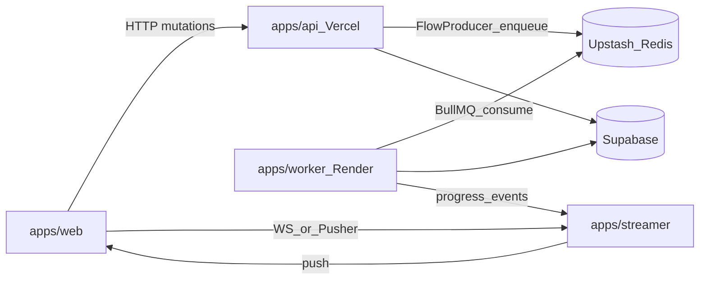

# Worker and streamer (jobs + realtime)

Status: **Plan** — architecture locks from brainstorm; not implemented.
Open for further enrich before scaffolding `apps/worker` / `apps/streamer`.

Related:

- System boundaries today: [TRD.md](./TRD.md) (Vercel `web` / `api`; no WebSockets on serverless)
- Charts Tier 2 foreshadowing: [CHARTS_AGGREGATION.md](../features/dashboard/CHARTS_AGGREGATION.md)
- Product roadmap context: [ROADMAP.md](../product/ROADMAP.md)

---

## Goals

Introduce two long-lived deployables beside the existing Vercel apps:

| App             | Role                                                                 |
| --------------- | -------------------------------------------------------------------- |
| `apps/worker`   | Queue consumers, crons, long-running jobs, AI agent tool execution   |
| `apps/streamer` | Realtime / WebSocket (or managed push) plane for live client updates |

`apps/web` and `apps/api` **keep those names**. Do not rename to `client` / `server` (or `writer`) for symmetry — role names scale better as more Node processes appear. A later `reader` (Neon read HTTP) may still land without renaming `web` / `api`.

---

## Locks (decided)

1. **Do not combine** streamer and worker into one process.
2. **Queue stack:** BullMQ + Upstash Redis (`ioredis`).
3. **Deploy:** `apps/worker` on Render (Background Worker). `apps/api` on Vercel **enqueues only**.
4. **Parent / child jobs:** BullMQ `FlowProducer` (or parent opts) + Postgres `job_runs` for product tracking.
5. **QStash is not the primary** job system (optional later for simple HTTP schedules only).

Still open (enrich later):

- Streamer: managed Pusher/Ably auth/BFF first vs native WebSocket server on Render
- First job kinds to ship (AI tools vs chart/Neon apply vs other)
- Exact `job_runs` schema and retention

---

## Why not combine streamer + worker

| Concern        | Streamer                                   | Worker                                  | If combined                                    |
| -------------- | ------------------------------------------ | --------------------------------------- | ---------------------------------------------- |
| Scale axis     | Open connections, memory, sticky affinity  | CPU, duration, queue concurrency        | One bad AI job or OOM restarts **all** sockets |
| Lifecycle      | Must stay up; restarts drop clients        | Restart-friendly; scale to N consumers  | Ops forced into the worse of both              |
| Failure domain | Auth, fan-out, backpressure                | Tool timeouts, retries, poison messages | Coupled blast radius                           |
| Deploy shape   | Few sticky instances (or managed realtime) | Many ephemeral workers                  | One knobs-for-everything service               |

AI agent tools amplify this: long runs, high memory, flaky third parties. Those belong in a process you can kill, retry, and scale independently of live connections.

A single **package** with two entrypoints deployed as **two Render services** is an acceptable bootstrap; merging into **one running process** is not.

---

## Target topology

- **`apps/api`:** sync HTTP, auth’d mutations, enqueue (202 + job / run id). No sockets, no agent tool loops, no BullMQ `Worker`.
- **`apps/worker`:** queue consumers, crons, AI tools, heavy apply jobs. Emits progress/completion for the streamer bus (Redis pub/sub, queue events, or managed push server API).
- **`apps/streamer`:** owns client realtime. Prefer managed (Pusher/Ably) + thin auth/BFF until outgrown; native WebSockets need sticky sessions and a reconnect protocol.
- **Shared packages (when implemented):** e.g. `@repo/jobs` (payloads, queue names, Flow helpers), optional `@repo/realtime` event names — Zod schemas shared by api + worker (+ streamer).

---

## Queue stack

### Recommendation

**BullMQ + Upstash Redis via `ioredis`.**

| Piece            | Role                                              | Use here?                                   |
| ---------------- | ------------------------------------------------- | ------------------------------------------- |
| Upstash Redis    | Managed Redis (TCP)                               | Yes — BullMQ broker                         |
| BullMQ + ioredis | Queues, workers, flows, retries, stalled recovery | Yes — primary workload API                  |
| Upstash QStash   | HTTP push into serverless endpoints               | No as primary                               |
| Upstash Workflow | Durable multi-step / human-in-the-loop            | Optional later; not needed for tool batches |

Charts Tier 2 “Upstash queue” should mean **Upstash Redis backing BullMQ**, not QStash replacing BullMQ.

### Parent / child batches (mental model)

Use BullMQ **`FlowProducer`** (or explicit parent + children):

- **Parent** — one logical unit (`agent-run`, `chart-rebuild`, `project-bootstrap`, …)
- **Children** — batched slices or tool steps (`tool:search`, `chunk:0..N`)
- BullMQ tracks child completion; parent can wait until children finish or fail
- Persist **`job_runs`** in Postgres (`id`, `parent_id`, `kind`, `status`, …) for UI/audit

Suggested flow:

1. API inserts Postgres `job_runs` parent (`parent_id` null).
2. API `FlowProducer.add({ …, data: { jobRunId }, children: […] })`.
3. Each child payload carries `jobRunId` + `parentJobRunId`.
4. Worker updates Postgres on active / progress / completed / failed.
5. Redis/BullMQ = **operational** queue; Postgres = **product** source of truth.

### Queue layout

Split by failure and concurrency profile — not one mega-queue:

| Queue      | Intent                     | Concurrency hint        |
| ---------- | -------------------------- | ----------------------- |
| `default`  | Short post-commit helpers  | Moderate                |
| `ai-agent` | Parent agent runs          | Low                     |
| `ai-tools` | Child tool executions      | Higher; strict timeouts |
| `heavy`    | Chart/Neon apply, rebuilds | 1–2                     |

Parents orchestrate on the orchestration queue; children run on specialist queues so a slow tool does not starve unrelated work.

### Deploy notes (Vercel + Render + Upstash)

- **Render:** Background Worker for `apps/worker` (scale instances; tune BullMQ `concurrency` per queue).
- **Vercel `api`:** producer only; short-lived ioredis connections; follow current BullMQ serverless producer guidance (avoid leaked connections).
- **`maxRetriesPerRequest: null`:** required for BullMQ **workers**; do not cargo-cult onto every producer without checking current BullMQ docs.
- **Upstash Redis:** TCP enabled; size for `api` burst producers + `N` worker connections; prefer a Redis DB (or key prefix) dedicated to BullMQ.
- **`lockDuration` / stalled intervals:** high enough for AI tools (minutes), or confine long work to `ai-tools` children with their own lock settings.

### Anti-patterns

- Running BullMQ workers inside `apps/api` (Vercel) — mid-job drops.
- Faking parent/child trees with QStash callbacks only.
- Treating Redis as the only history store (expire/clean BullMQ jobs; keep `job_runs`).
- Sharing one Redis DB with streamer state without strict key-prefix discipline.

---

## Sequencing

1. **Queue + `apps/worker` first** when long jobs / AI tools are the pain (api → 202 → worker).
2. **`apps/streamer` second** when the browser needs live progress / presence beyond current Supabase Realtime and client patterns.
3. Wire worker → streamer via **events**, not by importing streamer code into the worker process.

---

## Relation to charts Tier 2 / Tier 3

[CHARTS_AGGREGATION.md](../features/dashboard/CHARTS_AGGREGATION.md) already foreshadows Render `worker`, Upstash, and a streamer. This doc **narrows** that:

- Broker = Upstash Redis + BullMQ (not QStash-as-primary)
- Keep `web` / `api` names; add `worker` / `streamer` as siblings
- Tier 3 “rename to client/writer” in that file is **not** adopted for naming `web`/`api` — revisit only if a later program truly needs it

`reader` (Neon read HTTP) remains a separate future app; out of scope for the first worker/streamer slice.

---

## Implementation checklist (when picked up)

- [ ] Scaffold `apps/worker` (Render entrypoint, BullMQ workers, env for Upstash Redis)
- [ ] Add `@repo/jobs` (queue names, Zod payloads, Flow helpers); api produces, worker consumes
- [ ] Design and migrate `job_runs` (parent/child) in Supabase
- [ ] First real job kind + 202 enqueue path from `apps/api`
- [ ] Lock streamer approach (Pusher/Ably vs native WS); scaffold `apps/streamer` when needed
- [ ] Update [TRD.md](./TRD.md) deployment section when apps exist
- [ ] Align charts Tier 2 wording with BullMQ + Upstash Redis
- [ ] User-guide only when job progress is user-visible

---

## Enrich / brainstorm backlog

Capture follow-ups here as the design deepens:

- Idempotency keys and exactly-once vs at-least-once product expectations
- Poison-message / DLQ policy per queue
- Observability (job metrics, Render logs, correlation ids = `job_runs.id`)
- Local dev: Redis (Upstash or Docker) + `pnpm turbo` worker alongside `web`/`api`
- Auth: how workers call Supabase / internal APIs (service role vs signed job tokens)
- Agent tool sandboxing and timeout budgets
- Whether chart Tier 2 apply jobs share `heavy` with other rebuilds
