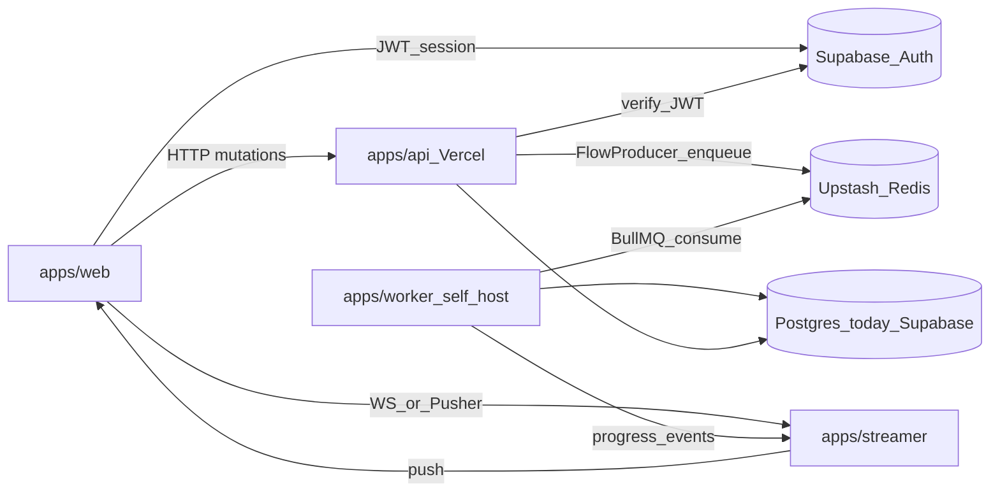
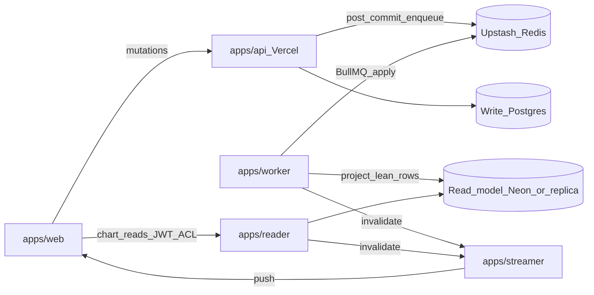

# Worker, streamer, and reader (jobs + realtime + read plane)

Status: **Partial** — `apps/worker` + `@repo/jobs` + GitHub sync / `workflow.run`
MVP landed. Next ops focus: **host the worker**. Streamer and reader still
plan-only. Charts **Tier 1** rollups stay in product docs; **Tier 2/3** read
plane lives here.

Related:

- System boundaries today: [TRD.md](./TRD.md) (Vercel `web` / `api`; no WebSockets on serverless)
- Charts Tier 1 (rollups, series APIs, burndown): [CHARTS_AGGREGATION.md](../features/dashboard/CHARTS_AGGREGATION.md)
- Product roadmap context: [ROADMAP.md](../product/ROADMAP.md)
- Worker VM sketch: [infrastructure/README.md](../../infrastructure/README.md)

---

## Goals

Introduce long-lived deployables beside the existing Vercel apps:

| App             | Role                                                                 |
| --------------- | -------------------------------------------------------------------- |
| `apps/worker`   | Queue consumers, crons, long-running jobs, AI agent tool execution   |
| `apps/streamer` | Realtime / WebSocket (or managed push) plane for live client updates |
| `apps/reader`   | Read HTTP API over a lean read model (charts / later whole-app)      |

`apps/web` and `apps/api` **keep those names**. Do not rename to `client` /
`server` (or `writer`) for symmetry — role names scale better as more Node
processes appear. Tier 2 may add `worker` / `streamer` / `reader` without
renaming `web` / `api`.

---

## Locks (decided)

1. **Do not combine** streamer and worker into one process. Reader stays
   HTTP-only (no BullMQ consumers in the reader process).
2. **Queue stack:** BullMQ + Upstash Redis (`ioredis`).
3. **Deploy (worker):** prefer **self-host** on free-tier-leaned OCI compute.
   Prefer Always Free Ampere `VM.Standard.A1.Flex` when the regional pool has
   capacity; if A1 is out of pool (e.g. Singapore), an **AMD** shape VM is an
   acceptable fallback (may not be Always Free–badged). IaC sketch under
   `infrastructure/create_virtual_machine/` still targets A1. Process
   supervision is systemd (runbook still open). `apps/api` on Vercel
   **enqueues only**. Cloud-native multi-service hosting is the **second**
   path, not the default.
4. **Parent / child jobs:** BullMQ `FlowProducer` (or parent opts) + Postgres `job_runs` for product tracking.
5. **QStash is not the primary** job system (optional later for simple HTTP schedules only).
6. **Supabase unwind (keep Auth):** keep developing on the current stack; over
   time move **database** and **storage** (and **RLS**) off Supabase offerings
   while **retaining Supabase Auth**. Hosting the worker does **not** wait on
   that migration.
7. **Charts scale path:** purpose-built **rollup tables** on the write DB first
   (Tier 1). Tier 2 moves chart (then lean `work_items`) reads to a **read
   model** served by `apps/reader`; worker applies queue projections. Do **not**
   rename `web`/`api` to client/writer for that program.

**Current worker host (ops):** Oracle **Singapore** AMD VM (Console-provisioned;
Always Free Ampere was out of pool). SSH works. Not managed by the A1 Terraform
sketch until imported or replaced.

Still open (enrich later):

- Streamer: managed Pusher/Ably auth/BFF first vs native WebSocket server
- Worker systemd + env runbook on the SSH-reachable VM; CI SSH deploy
- Exact `job_runs` retention and HITL UI
- Reader host shape (same VM as worker vs separate); Neon vs owned Postgres replica

---

## Hosting and scaling strategy

Free-tier leaned and **self-hosting first**. Cloud-native is available later
when clients and load justify it.

| Approach                     | Shape                                                                                                  | Fit                                                                        |
| ---------------------------- | ------------------------------------------------------------------------------------------------------ | -------------------------------------------------------------------------- |
| **Self-host (primary)**      | One (or few) VMs near the operator / client — worker now; later API/DB/storage/reader on owned compute | Easy deploy, Always Free / fixed cost, enough for early product            |
| **Cloud-native (secondary)** | Horizontally scaled API/worker/reader behind a load balancer; managed or owned Postgres + object store | Better multi-client scale once the data plane is not tied to full Supabase |

### Why not “easy cloud” with full Supabase

Full Supabase (PostgREST, Realtime, Storage API, Kong, Postgres, …) wants many
CPU-heavy containers. That fights free-tier and simple VM self-hosting. Auth
alone is the piece worth keeping managed.

### Supabase exit (Auth stays)

1. Keep shipping product on today’s Supabase Postgres / Storage / Auth.
2. Ensure **`apps/api` (and worker) are the only DB/storage clients** — no
   browser paths that depend on RLS as the security boundary.
3. Move **storage** → S3-compatible object store; **database** → owned Postgres
   **without RLS** (authorization stays in the API/RBAC layer).
4. Keep **Supabase Auth** (JWT / user lifecycle). Optionally self-host GoTrue
   much later; not required for the first exit.
5. After that cutover, self-host or cloud-host compute freely; add **vertical**
   then **horizontal** scale (more worker/reader replicas, LB in front of API)
   with better multi-client topology.

### Immediate goal

**Run `apps/worker` on the SSH-reachable OCI VM** (Node/pnpm or image, env,
systemd) against the current stack (Upstash + existing DB URL + service
credentials). Do not block on Always Free Ampere capacity, the Supabase unwind,
or `apps/reader`.

---

## Why not combine streamer + worker

| Concern        | Streamer                                   | Worker                                  | If combined                                    |
| -------------- | ------------------------------------------ | --------------------------------------- | ---------------------------------------------- |
| Scale axis     | Open connections, memory, sticky affinity  | CPU, duration, queue concurrency        | One bad AI job or OOM restarts **all** sockets |
| Lifecycle      | Must stay up; restarts drop clients        | Restart-friendly; scale to N consumers  | Ops forced into the worse of both              |
| Failure domain | Auth, fan-out, backpressure                | Tool timeouts, retries, poison messages | Coupled blast radius                           |
| Deploy shape   | Few sticky instances (or managed realtime) | Many ephemeral workers                  | One knobs-for-everything service               |

AI agent tools amplify this: long runs, high memory, flaky third parties. Those belong in a process you can kill, retry, and scale independently of live connections.

A single **package** with two entrypoints deployed as **two processes/hosts** is an acceptable bootstrap; merging into **one running process** is not.

**Reader** is a third axis: latency-sensitive HTTP reads against a lean model.
Do not put BullMQ consumers or agent tools in the reader process.

---

## Target topology

### Today → near-term (worker hosted, same DB)



### Charts / read plane Tier 2 (design)



```text
api post-commit → Upstash → worker apply → read model
web → reader (JWT + ACL) → read model
worker/reader → streamer → web invalidate
```

- **`apps/api`:** sync HTTP, auth’d mutations, enqueue (202 + job / run id). No sockets, no agent tool loops, no BullMQ `Worker`. Post-commit publisher (generic interceptor) enqueues projection / heavy jobs.
- **`apps/worker`:** queue consumers, crons, AI tools, heavy apply / Neon (or replica) projection jobs. Emits progress/completion for the streamer bus. Prefer self-hosted VM; scale replicas later.
- **`apps/streamer`:** owns client realtime. Prefer managed (Pusher/Ably) + thin auth/BFF until outgrown; native WebSockets need sticky sessions and a reconnect protocol.
- **`apps/reader`:** HTTP-only reads (charts first, then lean `work_items`). JWT + ACL; no queue consumers. Host self-first (may share a VM with worker initially; split when load requires).
- **Data plane (target):** write Postgres + object storage owned/self-hosted; **Supabase Auth only**. Today DB/storage may still be Supabase until the unwind lands. Tier 2 read model may be Neon or an owned replica — lock when implementing.
- **Shared packages:** `@repo/jobs` (payloads, queue names, Flow helpers), optional `@repo/realtime` event names — Zod schemas shared by api + worker (+ streamer / reader as needed).

---

## Charts Tier 2 / Tier 3

Product Tier 1 (categorical / hierarchy / burndown / contribution **rollups** on
the write DB) remains in
[CHARTS_AGGREGATION.md](../features/dashboard/CHARTS_AGGREGATION.md). That file
points here for scaling beyond same-DB reads.

| Tier  | Scope                                                                                                                                        | Status                |
| ----- | -------------------------------------------------------------------------------------------------------------------------------------------- | --------------------- |
| **1** | Same write DB: rollup tables + series/drilldown on `apps/api`                                                                                | Living in charts docs |
| **2** | Lean `work_items` (+ chart reads) on a **read model**; **`apps/reader`**; Upstash + BullMQ; api **post-commit** publish; streamer invalidate | Design only           |
| **3** | Whole-app reads on the read model; expand architecture when that program starts — **no** `web`/`api` rename for symmetry                     | Later                 |

### Tier 2 locks

- Browser → **`apps/reader`** → read model (Neon or owned replica)
- Enqueue: Express **post-commit** publisher → **Upstash Redis + BullMQ** (not QStash-as-primary)
- Read model holds a **lean** `work_items` projection (+ chart statistics), not a full row mirror of the whole schema
- Queue **consumer on `worker`**; **reader** HTTP-only
- **Streamer** = Pusher auth/BFF until outgrown (native WS later if needed)
- Cutover: dual-run + feature flag
- Worker / reader deploy: **self-host first** (Always Free / one big server); cloud-native LB scale second

### Tier 3 locks

- Whole-app reads on the read model
- Keep `web` / `api` names; do **not** adopt a client/writer rename for this program
- Own follow-up detail when started; this section only outlines the target

### Why rollups still matter before reader

| Concern        | Live join                              | Purpose-built rollup                     |
| -------------- | -------------------------------------- | ---------------------------------------- |
| Widget fan-out | N widgets × heavy joins                | One indexed read                         |
| Future reader  | Must replicate OLTP grain or recompute | Sync **small** statistics rows           |
| Function split | Couples reader to write grain          | Charts domain owns its statistics tables |

Tier 1 rollups are the scaling path **into** Tier 2 — not a detour.

---

## Queue stack

### Recommendation

**BullMQ + Upstash Redis via `ioredis`.**

| Piece            | Role                                              | Use here?                                   |
| ---------------- | ------------------------------------------------- | ------------------------------------------- |
| Upstash Redis    | Managed Redis (TCP)                               | Yes — BullMQ broker                         |
| BullMQ + ioredis | Queues, workers, flows, retries, stalled recovery | Yes — primary workload API                  |
| Upstash QStash   | HTTP push into serverless endpoints               | No as primary                               |
| Upstash Workflow | Durable multi-step / human-in-the-loop            | Optional later; not needed for tool batches |

Charts Tier 2 “Upstash queue” means **Upstash Redis backing BullMQ**, not QStash replacing BullMQ.

### Parent / child batches (mental model)

Use BullMQ **`FlowProducer`** (or explicit parent + children):

- **Parent** — one logical unit (`agent-run`, `chart-rebuild`, `project-bootstrap`, …)
- **Children** — batched slices or tool steps (`tool:search`, `chunk:0..N`)
- BullMQ tracks child completion; parent can wait until children finish or fail
- Persist **`job_runs`** in Postgres (`id`, `parent_id`, `kind`, `status`, …) for UI/audit

Suggested flow:

1. API inserts Postgres `job_runs` parent (`parent_id` null).
2. API `FlowProducer.add({ …, data: { jobRunId }, children: […] })`.
3. Each child payload carries `jobRunId` + `parentJobRunId`.
4. Worker updates Postgres on active / progress / completed / failed.
5. Redis/BullMQ = **operational** queue; Postgres = **product** source of truth.

### Queue layout

Split by failure and concurrency profile — not one mega-queue:

| Queue      | Intent                           | Concurrency hint        |
| ---------- | -------------------------------- | ----------------------- |
| `default`  | Short post-commit helpers        | Moderate                |
| `ai-agent` | Parent agent runs                | Low                     |
| `ai-tools` | Child tool executions            | Higher; strict timeouts |
| `heavy`    | Chart/read-model apply, rebuilds | 1–2                     |

Parents orchestrate on the orchestration queue; children run on specialist queues so a slow tool does not starve unrelated work.

### Deploy notes (Vercel + self-host worker + Upstash)

- **Worker host:** self-host on OCI (Ampere Always Free when available; AMD /
  other shapes when A1 pool is empty). SSH for bootstrap; systemd for process
  supervision; tune BullMQ `concurrency` per queue. Scale by more replicas /
  bigger box later — not by standing up full Supabase containers.
- **Reader host:** HTTP-only; may start on the same VM; split when chart/read
  traffic needs isolation from job CPU.
- **Vercel `api`:** producer only; short-lived ioredis connections; follow current BullMQ serverless producer guidance (avoid leaked connections).
- **`maxRetriesPerRequest: null`:** required for BullMQ **workers**; do not cargo-cult onto every producer without checking current BullMQ docs.
- **Upstash Redis:** TCP enabled; size for `api` burst producers + `N` worker connections; prefer a Redis DB (or key prefix) dedicated to BullMQ.
- **`lockDuration` / stalled intervals:** high enough for AI tools (minutes), or confine long work to `ai-tools` children with their own lock settings.

### Anti-patterns

- Running BullMQ workers inside `apps/api` (Vercel) — mid-job drops.
- Running BullMQ workers inside `apps/reader` — couples reads to job CPU/OOM.
- Faking parent/child trees with QStash callbacks only.
- Treating Redis as the only history store (expire/clean BullMQ jobs; keep `job_runs`).
- Sharing one Redis DB with streamer state without strict key-prefix discipline.

---

## Interim: in-process destructive jobs (today)

Until destructive/create kinds move fully onto BullMQ, **soft archive** and
**hard purge** (and project create) use the same HTTP shape the worker path will
keep:

1. API validates auth + optimistic lock (when applicable) **synchronously**.
2. Responds **202** `{ accepted, message, correlationId }`.
3. Runs the mutation **in-process** via `void` background work
   (`apps/api/src/lib/enqueue-destructive-action.ts`).
4. Writes an inbox notification on success/failure
   (`entity_archived` / `entity_archive_failed` / `entity_purged` /
   `entity_purge_failed`, plus existing `project_created` /
   `project_create_failed`).

Web clients use `skipDatabaseBusyRetry: true` on these acknowledges and toast
the accepted message; completion arrives through the inbox.

### Migration checklist → BullMQ

When picking up worker jobs for these kinds:

- [ ] Move `enqueueDestructiveAction` / project-create background runners to
      `FlowProducer.add` (or single-job enqueue) with stable job names
      (e.g. `entity.archive`, `entity.purge`, `project.create`)
- [ ] Persist `job_runs` keyed by today’s `correlationId` (or replace it)
- [ ] Keep HTTP **202** + `{ accepted, message, correlationId }` contract
- [ ] Keep inbox notification types and markdown link copy stable
- [ ] Remove in-process `void` runners from `apps/api` once the worker owns them
- [ ] Confirm Vercel `api` is producer-only (no long DB/storage work after 202)

## Sequencing

1. **Queue + `apps/worker` code** — landed for GitHub sync / `workflow.run`; migrate interim destructive/create jobs when ready.
2. **Host the worker** on the existing SSH-reachable OCI VM (systemd + env) against the **current** Supabase DB/Auth stack — do not wait for A1 Always Free, the data-plane unwind, or reader.
3. **Supabase unwind** — storage → object store; Postgres → owned DB without RLS; **keep Supabase Auth**. Then vertical/horizontal scale API + worker (replicas, LB) as clients grow.
4. **`apps/streamer`** when the browser needs live progress / presence beyond current Supabase Realtime and client patterns.
5. Wire worker → streamer via **events**, not by importing streamer code into the worker process.
6. **`apps/reader` + Tier 2 read model** when chart (or other) same-DB reads need isolation — after Tier 1 rollups and worker hosting are solid.

---

## Implementation checklist

- [x] Scaffold `apps/worker` (BullMQ workers, env for Upstash Redis)
- [x] Add `@repo/jobs` (queue names, Zod payloads; Flow helpers later); api produces, worker consumes
- [x] Design and migrate `job_runs` (parent/child column; FlowProducer later) in Supabase
- [x] First real job kind + 202 enqueue path from `apps/api` (`github.webhook.ingest`)
- [ ] Run `apps/worker` on OCI VM (SSH ok; systemd runbook, env/secrets)
- [ ] Supabase unwind: owned Postgres (no RLS) + object storage; keep Supabase Auth
- [ ] Lock streamer approach (Pusher/Ably vs native WS); flesh out `apps/streamer` when needed
- [ ] Scaffold `apps/reader`; post-commit publisher → worker apply → read model; dual-run cutover
- [ ] Update [TRD.md](./TRD.md) deployment section when worker is hosted
- [ ] Keep [CHARTS_AGGREGATION.md](../features/dashboard/CHARTS_AGGREGATION.md) Tier 1-only; Tier 2/3 points here
- [ ] User-guide only when job progress is user-visible

### Source-control / agent job kinds (planned)

GitHub App sync and later agent workflows are first-class candidates for worker
job kinds. Product phases live in
[GITHUB_INTEGRATION.md](../features/projects/GITHUB_INTEGRATION.md)
(Phased delivery). Draft names (finalize in `@repo/jobs`):

| Kind (draft)                    | Phase | Role                                                                             |
| ------------------------------- | ----- | -------------------------------------------------------------------------------- |
| `github.webhook.ingest`         | 2     | After API HMAC verify — normalize payload, idempotency key, fan-out (**landed**) |
| `github.sync.pull_request`      | 2     | Upsert PR (+ link work item when resolvable) (**landed**)                        |
| `github.sync.push`              | 2     | Commits / branch tip upserts (**landed**)                                        |
| `github.sync.branch`            | 2     | Branch create/delete upserts (**landed**)                                        |
| SC domain events                | 3     | Emit after sync + enqueue `workflow.run` (**landed**)                            |
| `workflow.run`                  | 4     | Persist `job_runs`, HITL park (`awaiting_human`) (**MVP landed**; agents later)  |
| `agent.tool.cursor` (and peers) | 4     | Long agent tool execution; never on `apps/api`                                   |

Webhook HTTP handlers on `apps/api` **verify + enqueue only**. Agent tool loops
and sync apply logic run on `apps/worker`.

---

## Enrich / brainstorm backlog

Capture follow-ups here as the design deepens:

- Idempotency keys and exactly-once vs at-least-once product expectations
- Poison-message / DLQ policy per queue
- Observability (job metrics, VM/systemd logs, correlation ids = `job_runs.id`)
- Local dev: Redis (Upstash or Docker) + `pnpm turbo` worker alongside `web`/`api`
- Auth: workers use service role / DB URL today; after Auth-only Supabase, still verify JWTs at API / reader edge
- Cutover plan for Storage → S3-compatible and Postgres → owned instance without dual-write pain
- Reader ACL parity with `listAccessibleProjectIds`; feature-flag dual-run for chart reads
- Neon vs owned Postgres replica for the Tier 2 read model
- Agent tool sandboxing and timeout budgets
- Whether chart Tier 2 apply jobs share `heavy` with other rebuilds
- GitHub webhook retry / delivery replay vs Alice idempotency keys
- Human-in-the-loop gates for PR-comment → agent resolve workflows
