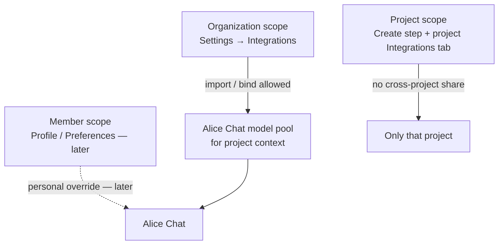

# Integration scopes (Organization / Project / Member)

Status: **In progress** — Phases **A** + **B** + **C** (slice) shipped. Schema
has `IntegrationScope` (default `organization`) and
`project_integration_bindings`. Chat resolves models with **project → page →
org**. Create wizard uses a single **Integrations** step (Jira + GitHub + AI
binds). Project **Integrations** tab includes an **AI agents** bind card.
Phase 1 Settings marketplace remains the **Organization vault**
(`SETTINGS_INTEGRATIONS.md`).

Alice today stores chat-model (and future Slack/etc.) rows as **deployment-wide
workspace integrations**. This document adds a first-class **scope** and the
**project-first UX** for binding those integrations.

Related:

- Living Settings marketplace: [SETTINGS_INTEGRATIONS.md](./SETTINGS_INTEGRATIONS.md)
- Index: [README.md](./README.md)
- Alice Chat: [AI_CHATBOT.md](../chat/AI_CHATBOT.md)
- Project GitHub/Jira: [GITHUB_INTEGRATION.md](../projects/GITHUB_INTEGRATION.md),
  [JIRA_INTEGRATION.md](../projects/JIRA_INTEGRATION.md)
- Project create UX: [create-project.md](../../user-guide/projects/create-project.md)
- Project integrations UX: [project-integrations.md](../../user-guide/projects/project-integrations.md)
- RBAC: [RBAC_AUTHORIZATION_SKELETON.md](../../auth/RBAC_AUTHORIZATION_SKELETON.md)

---

## Goals

- **Primary UX move:** configure project integrations on **create (wizard step)**
  and **edit (Integrations tab)** — not only in Settings.
- Introduce **`scope`**: `organization` | `project` | `member`.
- Mark **all current** Settings → Integrations rows as **`organization`**.
- Let **managers and admins** customize AI models (not admin-only).
- Resolve Alice Chat models with **project as default context**, then **page**
  as secondary context (fallback chain below).
- Allow **sharing / import** only for **organization**-scoped integrations.
  **Project**-scoped integrations are **not** shareable across projects
  (except via explicit org-level promotion, if we add that later).
- Consolidate today’s create **Imports** (Jira) + **Source** (GitHub) into the
  same **Integrations** step as AI model bind/import.

## Non-goals (this plan)

- Multi-tenant `organizations` table / multi-workspace SaaS (Alice remains one
  deployment ≈ one organization until a later product decision).
- Member-scoped OAuth for every catalog provider in the first slice.
- Automatic overnight rewrite of model ids (still the pinned-catalog policy in
  `SETTINGS_INTEGRATIONS.md`).
- Deleting Settings → Integrations in v1 — it remains the **Organization**
  catalog/vault where shareable providers are created.

---

## Scope definitions

| Scope            | Meaning                                                                | Who configures                      | Share / import                                      |
| ---------------- | ---------------------------------------------------------------------- | ----------------------------------- | --------------------------------------------------- |
| **Organization** | Deployment-wide defaults (today’s Settings → Integrations)             | Admin + **manager**                 | **Yes** — projects may import/bind org integrations |
| **Project**      | Bound to one `projects.id`; used when that project is the chat context | Admin + manager with project access | **No** — not copyable to other projects             |
| **Member**       | Bound to one `users.id`; personal keys / prefs (future)                | The member (and admin override TBD) | **No**                                              |

**Organization ≈ current workspace.** Naming “Organization” in the product UI
avoids “workspace” overload with chart workspaces and keeps room for a future
multi-org tenancy without renaming again.



---

## Chat context resolution

When Alice needs a model (or later a tool integration):

1. **Project context (default)** — if the session/page has an active project
   (project workspace, work item, backlog, sprint in a project, create wizard
   project, etc.), use that project’s enabled model pool:
   - Project-scoped bindings first (if any),
   - else organization integrations **imported/enabled for that project**,
   - else organization default.
2. **Page context (second)** — if no project can be inferred, use page-level
   hints (e.g. Charts/Views with an associated project, deep link query). If
   still none, use **organization** defaults only.
3. **Member overrides (later)** — optional personal default model when org/project
   allow it; not required for the first delivery.

Explicit user model picker in the chat header continues to constrain the pool
to models the resolved scope makes available (never leak another project’s
private keys).

---

## Surfaces (target)

| Surface                                | Role                                                                  |
| -------------------------------------- | --------------------------------------------------------------------- |
| Settings → Integrations                | **Organization vault** — create/edit shareable providers (AI, Slack…) |
| Project create → **Integrations** step | Grouped catalog; bind/configure before async create                   |
| Project → **Integrations** tab         | Same marketplace-style UI as Settings, plus SC / PM groups            |
| Profile / Preferences                  | **Member** scope later                                                |
| Alice Chat                             | Resolved pool: project → page → organization                          |

### Integration category groups (UI)

Both the create **Integrations** step and the project **Integrations** tab
organize providers into grouped lists / filter tabs:

| Group                    | Examples (today / planned)          | Cardinality at **project** level   |
| ------------------------ | ----------------------------------- | ---------------------------------- |
| **Source control**       | GitHub                              | **Single** — radio (or none)       |
| **Project management**   | Jira Cloud                          | **Single** — radio (or none)       |
| **AI agents**            | Gemini, SpaceXAI, OpenAI, Anthropic | **Multiple** allowed (bind/enable) |
| **Communication**        | Slack                               | Multiple (when live)               |
| **Design & diagramming** | Figma, Eraser                       | Multiple (when live)               |
| **Productivity** / other | Linear, Notion, …                   | Multiple (planned catalog)         |

**Source control** and **project management** never allow two concurrent
providers on one Alice project (no GitHub+GitLab at once, no Jira+Linear PM
slot at once in v1). UI: **radio** within that group (plus explicit “None”).

Other groups reuse the Settings marketplace pattern (cards / multi-enable) so
several AI models can be bound to one project.

```text
Project Integrations UI
├── [tabs/groups] Source control | Project management | AI agents | …
├── Source control      → radio: None | GitHub | …
├── Project management  → radio: None | Jira Cloud | …
└── AI agents / …       → Settings-style cards (multi)
```

### Project create wizard (target step list)

Today (create): `Details` → `Types` → `Imports` → `Source` → `Sprint` → `Team`.

Target (create):

1. **Details**
2. **Types**
3. **Integrations** — replaces separate **Imports** + **Source**:
   - Grouped lists as above (SC radio, PM radio, other groups multi)
   - Bind organization vault providers and/or configure new project-level
     credentials where allowed
   - Optional: import setup from another project the actor belongs to
     (org binds / metadata only — see sharing rules)
4. **Sprint** (create only)
5. **Team** (create only)

### Project details → Integrations tab (target)

`/projects/[id]?tab=integrations` adopts the **current Settings → Integrations
marketplace UI** (search, category tabs/groups, cards), with **Source control**
and **Project management** groups added and constrained to radios.

Managers/admins with project access edit bindings here. Settings remains
required only to mint **new organization-scoped** providers/keys for sharing.

---

## Drafts, secrets, and async create

### Create drafts

Project create **draft auto-save / resume** must keep the Integrations step
intact across reloads:

- Selected group radios (SC / PM)
- Enabled AI (and other multi) catalog ids / bind choices
- In-progress form fields for new configs (display label, model id, flags)
- **API keys are omitted from drafts (locked):** never write key material to
  `localStorage` / draft JSON. After resume, the user **re-enters** any new key
  (org **bind-by-reference** needs no key). After the key is **persisted by the
  API**, the UI never shows plaintext again (masked, unmaskable).

Draft schema gains an `integrations` blob (alongside today’s `imports` /
`sourceControl`) so resume does not drop SC/PM/AI choices.

### Masked API keys (unmaskable)

For any integration created as **new** (org vault or project-only):

- After save, the API key input shows **bullet/mask placeholders only**
- **No reveal / unmask** control — keys are write-once from the client’s
  perspective (replace by entering a new value; blank keeps existing)
- Matches current Settings chat-model key behavior; project UI must not regress

### Async project creation (unchanged contract)

Create stays **asynchronous** as today:

1. Client submits create (including Integrations step payload).
2. Backend **acknowledges** quickly (accepted / queued).
3. Worker/path creates the project, applies bindings, runs Jira import / GitHub
   link side effects as configured.
4. User is notified via **dashboard inbox** (ready or failure), not blocked on
   the wizard.

Integrations work on create is part of that same async pipeline — the wizard
must not wait for import completion.

---

## Sharing rules (authoritative)

1. **Only organization-scoped** integrations may be **shared or imported** into
   projects (enable/bind, not necessarily clone ciphertext).
2. **Project-scoped** integrations **cannot** be imported into another project.
   To reuse elsewhere, an admin/manager must create or promote an
   **organization** integration (separate flow; out of scope for v1 if costly).
3. **Import authorization**: the actor must be a **manager or admin** **and** a
   **member of the source project** when the import UI lists “projects I can
   copy settings from.” Copying **configuration metadata** (provider, model id,
   label) is allowed; copying **encrypted API keys** requires either:
   - **Reference** the org integration (preferred — one secret, many projects), or
   - Explicit “duplicate secret” with audit log (discouraged).
4. Prefer **bind-by-reference** to organization rows over duplicating keys per
   project.

---

## RBAC (draft)

| Action                                      | Admin | Manager                         | Member            |
| ------------------------------------------- | ----- | ------------------------------- | ----------------- |
| Manage organization integrations            | Yes   | Yes                             | No                |
| Manage project integrations (own projects)  | Yes   | Yes (project membership)        | No                |
| Import org → project                        | Yes   | Yes (target project membership) | No                |
| Import from another project’s _settings UI_ | Yes\* | Yes\*                           | No                |
| Use models in chat from resolved pool       | Yes   | Yes                             | Yes               |
| Member-scoped personal keys                 | TBD   | TBD                             | Self only (later) |

\*Only if the actor is a **member of the source project** whose settings are
listed. Org-level catalog import does not require a source project.

---

## Data model (sketch)

Additive; exact migration TBD.

```text
integrations
  + scope            enum organization | project | member  -- default organization
  + project_id       uuid null  -- required when scope = project
  + owner_user_id    uuid null  -- required when scope = member
  + source_integration_id uuid null  -- optional bind/import lineage

-- Optional join if “enabled for project” without cloning rows:
project_integration_bindings
  project_id
  integration_id          -- usually organization-scoped row
  is_default_for_project
  created_by / timestamps
```

**Migration of current rows:** set `scope = organization`, `project_id = null`.
Phase **B** ships the bindings table + chat resolution; with an empty bindings
table, chat still uses the organization default (no user-visible change until
Phase **C** writes rows).

GitHub/Jira may remain on existing project tables in v1, documented as
**project-scoped** in product language, with a later optional move into
`integrations` + `scope = project`.

---

## Phased delivery

| Phase | Deliverable                                                                                                                                                         | Depends on |
| ----- | ------------------------------------------------------------------------------------------------------------------------------------------------------------------- | ---------- |
| **A** | Docs + `IntegrationScope` / `integrations.scope` default `organization` (**done**)                                                                                  | —          |
| **B** | Chat resolution project → page → org; `project_integration_bindings`; managers already configure org Settings (**done**)                                            | A          |
| **C** | **UX move:** create **Integrations** step (merge Imports+Source+AI); project Integrations tab AI binds (**done** — full Settings-style marketplace polish deferred) | B          |
| **D** | Import-from-project-I-belong-to (org binds / metadata only)                                                                                                         | C          |
| **E** | Member scope (optional personal models)                                                                                                                             | B          |
| **F** | Optional: unify GitHub/Jira rows under `integrations.scope = project`                                                                                               | C          |

**Shipping order intent:** land **C** as soon as **B** is safe — the product
requirement is that project create/details are where integrations are wired.

---

## Open questions

1. Should “promote project → organization” exist in v1, or only org→project bind?
2. Can a project **disable** an org-imported model without affecting other projects?
3. Drawer chat without project context: always org pool, or prompt to pick a project?
4. Audit: log every import/bind and every secret duplicate attempt.

---

## Decision summary

| Topic                 | Decision                                                                                                    |
| --------------------- | ----------------------------------------------------------------------------------------------------------- |
| Scope enum            | `organization` \| `project` \| `member`                                                                     |
| Current rows          | **Organization**                                                                                            |
| Org → project         | **Bind/reference** by default — not clone-as-project-scope                                                  |
| Who customizes models | **Managers and admins**                                                                                     |
| Chat context          | **Project default**, **page second**, then organization                                                     |
| Share / import        | **Organization only**; project scope does not share                                                         |
| Import auth           | Manager/admin **and** member of source project when listing projects                                        |
| Create / details UI   | Grouped lists; Settings-like marketplace on details tab                                                     |
| Source control / PM   | **Single** per project — **radio** (+ None)                                                                 |
| Other groups          | **Multiple** allowed                                                                                        |
| API keys              | After persist: **masked, unmaskable**; blank = keep existing                                                |
| Drafts                | Integrations selections resume; **API keys omitted** — re-enter after resume (unless org bind-by-reference) |
| Project create        | **Async** ack + background create/import (current behavior)                                                 |
| Secrets               | Prefer **reference org** over cloning keys                                                                  |

---

## Acceptance (when implemented)

- [x] Existing Settings integrations behave as organization scope with no regression.
- [x] Managers can configure organization AI models in Settings (vault).
- [x] Create wizard exposes a single **Integrations** step (Jira + GitHub + AI binds).
- [ ] Source control and project management use **radio** (single) selection (still checkbox enable today).
- [ ] Project **Integrations** tab mirrors Settings marketplace UI + SC/PM groups (AI card shipped; full marketplace polish deferred).
- [x] Draft resume restores Integrations selections (incl. AI binds); keys never drafted.
- [x] Create remains async (ack → background work → inbox notification).
- [x] Chat with project context uses that project’s enabled pool; without project, page then org (empty bindings ⇒ org).
- [ ] Project cannot import another project’s project-scoped integration.
- [x] Organization integrations are **bound** into projects (not copied to project scope by default).
- [x] Feature + user-guide docs updated for shipped Phase C surfaces.
