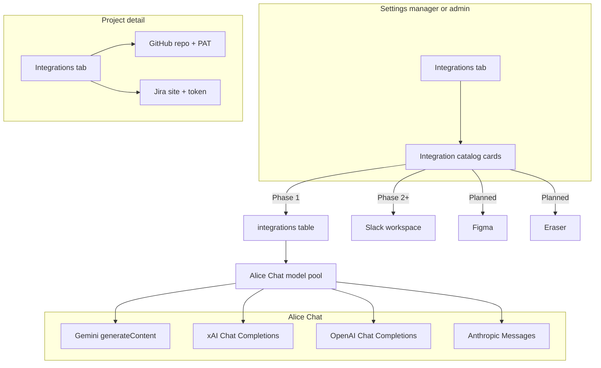
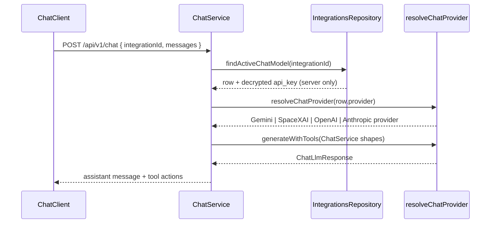

# Settings — Integrations (manager/admin)

Status: **Phase 1 complete** — DB-backed workspace integrations, the Settings
management UI, and the Alice Chat model pool are live. Phase 2 (Slack OAuth,
Figma/Eraser) remains planned.

Managers and admins configure **workspace-wide** AI agents and tool
integrations from **`/settings?tab=integrations`**. This is separate from
**project-scoped** integrations (GitHub and Jira on
`/projects/[id]?tab=integrations`).

Related:

- Index: [README.md](./README.md)
- Account settings: [features/profile/EDIT_PROFILE.md](../profile/EDIT_PROFILE.md)
- Alice Chat: [features/chat/AI_CHATBOT.md](../chat/AI_CHATBOT.md)
- Project GitHub/Jira: [features/projects/GITHUB_INTEGRATION.md](../projects/GITHUB_INTEGRATION.md), [JIRA_INTEGRATION.md](../projects/JIRA_INTEGRATION.md)
- RBAC: [auth/RBAC_AUTHORIZATION_SKELETON.md](../../auth/RBAC_AUTHORIZATION_SKELETON.md)

---

## Goals

- Single **Integrations** entry in the Settings sidebar for managers and admins.
- Surface a **catalog** of AI agents and workspace tools with clear status:
  **Connected**, **Preview**, and **Coming soon**.
- **Phase 1 (done):** Managers and admins configure chat models in Settings; Alice Chat reads active rows from `integrations` (no provider-key env bootstrap).
- Keep project-level dev-tool integrations (GitHub, Jira) on the project detail page — do not duplicate them here.

## Non-goals (Phase 0 — done)

- OAuth flows, webhooks, or encrypted credential storage for Slack / Figma / Eraser
- Per-user integration tokens (a workspace manager or admin configures once)
- Member visibility of the Integrations tab (hidden in nav; URL coerces to General)

Phase 1 provides DB-backed credentials and multi-model Alice Chat — see
[Database persistence](#database-persistence).

---

## Access control

| Layer            | Behavior                                                                                                                                    |
| ---------------- | ------------------------------------------------------------------------------------------------------------------------------------------- |
| Settings sidebar | **Integrations** is rendered for managers and admins                                                                                        |
| URL              | `/settings?tab=integrations` requested by a member → coerce to `general`                                                                    |
| API              | List/detail/create/update/disable operations independently require a manager or admin; chat-model discovery allows every authenticated role |

Members continue to use self-service tabs (General, Security, Notifications,
Preferences) only.

---

## Surfaces

```text
/settings?tab=integrations     ← workspace AI & tools (manager/admin)
/projects/[id]?tab=integrations ← GitHub + Jira (project members with access)
/chat                          ← Alice assistant (uses the selected configured model)
```



---

## Integration catalog (phased)

### Phase 0 — Marketplace UI (done)

| Integration                      | Category      | Catalog status | Backend implementation                      |
| -------------------------------- | ------------- | -------------- | ------------------------------------------- |
| **Gemini**                       | AI agents     | Preview        | Native `generateContent` provider           |
| **xAI / SpaceXAI**               | AI agents     | Preview        | OpenAI-compatible Chat Completions provider |
| **OpenAI**                       | AI agents     | Preview        | Chat Completions provider                   |
| **Anthropic**                    | AI agents     | Preview        | Messages provider                           |
| **Slack**                        | Communication | Preview        | No production connection                    |
| **Eraser / Figma**               | Design        | Coming soon    | None                                        |
| **Other suggested integrations** | Various       | Coming soon    | None                                        |

The four AI catalog entries intentionally retain the internal `mock` status,
which the UI labels **Preview**. They are configurable and have backend
provider strategies, but live OpenAI and Anthropic verification is not
confirmed. A dialog changes to **Connected** when at least one active model row
has a stored API key. **Connected** describes stored configuration, not a
successful live provider request.

Static catalog metadata lives in `settings-integration-catalog.ts` (names,
descriptions, filter tabs). **Configured instances** are stored in the
`integrations` table.

### Phase 1 — `integrations` table + Alice Chat model pool

- The **`integrations`** Postgres table stores a category column and JSONB
  `config` on the same row.
- Manager/admin saves API keys and model settings from Settings → Integrations; secrets are encrypted in `config` via existing `token-crypto.ts`.
- **`ChatService`** resolves the selected model from DB rows where
  `category = ai_agent`, using a **provider strategy** (Gemini, SpaceXAI,
  OpenAI, or Anthropic) instead of a hard-coded `CHAT_MODELS` constant.
- Users pick any **active chat model** from the pool in `/chat` and the navbar drawer.
- No env bootstrap — a manager or admin creates the first model row in Settings.

### Phase 2 — OAuth and notification integrations

- Slack: bot token in `config`, default channel, notify on work-item events.
- Figma / Eraser: link files or boards to epics/stories.

### Phase 3 — Routing and automation

- Optional rules (e.g. “coding tasks → model A”).
- Zapier-style triggers using the same `integrations` rows.

---

## UI structure

Settings sidebar adds **Integrations** for managers and admins. Content sections:

1. **AI & chat** — configurable Gemini, SpaceXAI, OpenAI, and Anthropic cards.
2. **Workspace & conversations** — Slack (mock).
3. **Design & diagramming** — Figma, Eraser (mock).
4. **Coming soon** — grid of suggested integrations with short descriptions.

Card pattern reuses project integration visuals (`Card`, status `Badge`, disabled primary actions with “Coming soon” copy).

Turning a connected card **switch off** opens the shared
`RegistryConfirmDialog` (rose warning). Confirming disables every active
`integrations` row for that catalog; cancel leaves the switch on.

Implementation:

- `apps/web/app/settings/_components/settings-integrations-view.tsx`
- `apps/web/app/settings/_helpers/workspace-integration-disconnect-copy.ts`
- `apps/web/app/settings/_components/settings-integration-catalog.ts` — static catalog metadata
- `settings-workspace.tsx` — conditional nav item
- `settings-data.tsx` — manager/admin gate + tab routing
- `lib/search-params.ts` — `integrations` on `SettingsTab`

---

## Database persistence

Alice is a **single workspace per deployment** (no `workspaces` table today).
All integration rows are **deployment-wide**—a manager or admin configures
tools for everyone, matching Settings → Integrations RBAC.

Project-scoped GitHub/Jira credentials **stay on `projects`** and `jira_connections`; this table is for **workspace-level** tools only (chat models, Slack, Figma, etc.).

### Design principles

| Principle            | Decision                                                                                                                               |
| -------------------- | -------------------------------------------------------------------------------------------------------------------------------------- |
| One table            | `integrations` holds every configured integration instance                                                                             |
| Category column      | Indexed enum aligned with Settings filter tabs — simplifies `WHERE category = …`                                                       |
| Config on same row   | Non-secret settings + encrypted secrets in one **`config` JSONB** column (no separate secrets table)                                   |
| Static vs dynamic    | **Catalog** (marketing copy, website URLs) stays in TS; **DB rows** are manager/admin-enabled instances linked by `catalog_id`         |
| Multiple chat models | **One row per chat model** (e.g. Gemini 3.6, GPT-4o, Claude Sonnet) so users get a **model pool** in Alice Chat                        |
| Encryption           | Reuse `encryptSecret` / `decryptSecret` from `apps/api/src/lib/secrets/token-crypto.ts` (`INTEGRATION_TOKEN_ENCRYPTION_KEY`)           |
| Client contract      | API never returns ciphertext; expose `has_*` booleans (same pattern as `withoutIntegrationSecrets` on projects)                        |
| Access               | Table is **service-role only** (RLS revoke for `anon` / `authenticated`); management goes through `apps/api` with manager/admin checks |

### Table schema

```prisma
enum IntegrationCategory {
  ai_agent
  communication
  design
  productivity
}

enum IntegrationStatus {
  active
  disabled
  draft
}

/// Workspace-level integration instance (one row per configured model or OAuth app).
model integrations {
  id          String               @id @default(dbgenerated("gen_random_uuid()")) @db.Uuid
  /// Matches static catalog id, e.g. "alice-gemini", "openai", "slack".
  catalog_id  String
  category    IntegrationCategory
  /// Provider slug for chat dispatch: gemini | spacexai | openai | anthropic.
  provider    String
  /// Admin-facing label, e.g. "Gemini 3.6", "GPT-4o (production)".
  name        String
  status      IntegrationStatus    @default(draft)
  /// Provider-specific JSON; secret fields stored as v1:… ciphertext.
  config      Json                 @default("{}")
  /// Default model for Alice Chat when user has not picked one (ai_agent only).
  is_default  Boolean              @default(false)
  sort_order  Int                  @default(0)
  created_by  String?              @db.Uuid
  created_at  DateTime             @default(now()) @db.Timestamptz(6)
  updated_by  String?              @db.Uuid
  updated_at  DateTime             @updatedAt @db.Timestamptz(6)

  created_by_user users? @relation("IntegrationCreatedBy", fields: [created_by], references: [id], onDelete: SetNull)
  updated_by_user users? @relation("IntegrationUpdatedBy", fields: [updated_by], references: [id], onDelete: SetNull)

  @@index([category, status])
  @@index([catalog_id])
  @@index([provider, status])
}
```

**Partial unique index** (SQL migration, not Prisma-native): at most one `is_default = true` among `category = ai_agent` and `status = active`.

Category values map to Settings filter tabs:

| DB `IntegrationCategory` | Settings filter tab  |
| ------------------------ | -------------------- |
| `ai_agent`               | AI agents            |
| `communication`          | Communication        |
| `design`                 | Design & diagramming |
| `productivity`           | Productivity         |

### `config` JSONB shapes

Validated with Zod discriminated unions in `@repo/types` (`integrations/config.ts`). Secret field names are fixed so the service layer can encrypt/decrypt on write/read.

#### AI agent — chat model (`provider: gemini | spacexai | openai | anthropic`)

```json
{
  "kind": "chat_model",
  "model": "gemini-3.6-flash",
  "model_version": "3.6",
  "display_label": "Gemini 3.6",
  "api_url": "https://generativelanguage.googleapis.com/v1beta/models/gemini-3.6-flash:generateContent",
  "api_key": "v1:…"
}
```

| Field           | Secret? | Notes                                                                |
| --------------- | ------- | -------------------------------------------------------------------- |
| `kind`          | No      | Always `chat_model` for Alice Chat rows                              |
| `model`         | No      | Provider model id sent to the API                                    |
| `model_version` | No      | Shown in UI; optional patch version                                  |
| `display_label` | No      | Chat dropdown label                                                  |
| `api_url`       | No      | Optional official provider endpoint; custom hosts are rejected       |
| `api_key`       | **Yes** | AES-256-GCM `v1:` blob; client sends plaintext only on create/update |

OpenAI example — same shape, different defaults:

```json
{
  "kind": "chat_model",
  "model": "gpt-4o",
  "model_version": "2024-08-06",
  "display_label": "GPT-4o",
  "api_url": "https://api.openai.com/v1/chat/completions",
  "api_key": "v1:…"
}
```

The Settings form supplies suggested model buttons, a custom **Model id**, a
**Display label**, a password-style **API key** field, and **Use as workspace
default in chat**. **Add model** creates another integration row under the same
provider, so each model keeps its own identity, API key, active state, and
display label.

Creating a model requires an API key. Existing keys are never returned to the
form; leaving the field blank while editing preserves that row's encrypted
key. The current form uses the provider's approved default endpoint and does
not expose `api_url` as an editable field.

#### Communication — Slack (Phase 2)

```json
{
  "kind": "slack_workspace",
  "team_id": "T01234567",
  "team_name": "Alice HQ",
  "default_channel_id": "C01234567",
  "bot_token": "v1:…"
}
```

#### Design — Figma (Phase 2)

```json
{
  "kind": "figma_oauth",
  "access_token": "v1:…",
  "refresh_token": "v1:…",
  "expires_at": "2026-12-01T00:00:00.000Z"
}
```

Non-secret keys remain plaintext inside JSONB; only values listed in `INTEGRATION_SECRET_KEYS` (types package) are encrypted.

### Query patterns

| Use case                                   | Query                                                                           |
| ------------------------------------------ | ------------------------------------------------------------------------------- |
| Settings marketplace — connected AI agents | `SELECT * FROM integrations WHERE category = 'ai_agent' AND status = 'active'`  |
| Alice Chat model dropdown                  | Same + `config->>'kind' = 'chat_model'`; order by `sort_order`, `name`          |
| Resolve default model                      | `WHERE category = 'ai_agent' AND is_default AND status = 'active' LIMIT 1`      |
| Slack notification worker                  | `WHERE category = 'communication' AND provider = 'slack' AND status = 'active'` |
| Admin edit by catalog card                 | `WHERE catalog_id = $1` (may return 0..n rows for multi-model providers)        |

Chat sends `integrationId` (UUID) on `POST /api/v1/chat` instead of a
free-form model string.

### Provider strategy (backend)

Chat providers live in a small registry under `apps/api`:

```text
apps/api/src/routes/api/integrations/
  integrations.router.ts
  integrations.service.ts      # CRUD, encrypt config secrets, strip for JSON
  integrations.repository.ts
  chat-providers/
    chat-provider.types.ts     # ChatModelProvider (ChatService shapes)
    fetch-chat-provider-with-retries.ts  # shared retry / error loop
    gemini/                    # Gemini wire adapters + provider
    spacexai/                  # OpenAI-compatible xAI adapters + provider
    openai-chat.provider.ts
    anthropic-chat.provider.ts
    resolve-chat-provider.ts   # provider slug → implementation
```

```typescript
/** Minimal contract — tools + system instruction stay in ChatService. */
interface ChatModelProvider {
  readonly provider: string;
  generateWithTools(input: {
    apiKey: string;
    apiUrl: string;
    model: string;
    contents: ChatContentTurn[];
    systemInstruction: string;
    tools: AliceChatTools;
  }): Promise<ChatLlmResponse>;
}
```

Strategies map `AliceChatTools` / `ChatContentTurn` / `ChatLlmResponse` to each
vendor’s wire format (Gemini `functionDeclarations`, OpenAI `tools`, etc.).

Flow:



`packages/types/src/chat-models.ts` contains **shared DTO types** and default
fallbacks; the runtime registry is DB-driven.

### API surface (v1)

| Method   | Versioned path                     | Auth          | Purpose                                    |
| -------- | ---------------------------------- | ------------- | ------------------------------------------ |
| `GET`    | `/api/v1/integrations`             | Manager/admin | List rows with secrets stripped            |
| `GET`    | `/api/v1/integrations/chat-models` | Authenticated | List active chat models for the dropdown   |
| `GET`    | `/api/v1/integrations/:id`         | Manager/admin | Read Settings detail with secrets stripped |
| `POST`   | `/api/v1/integrations`             | Manager/admin | Create a row and encrypt config secrets    |
| `PATCH`  | `/api/v1/integrations/:id`         | Manager/admin | Update; omit the API key to preserve it    |
| `DELETE` | `/api/v1/integrations/:id`         | Manager/admin | Disable the row and clear its default flag |

The API also mounts these routes under the backward-compatible
`/api/integrations` prefix. The current Settings client uses that unversioned
prefix; Alice Chat model discovery uses
`GET /api/v1/integrations/chat-models`. There is no provider health-check
endpoint in the current implementation.

Wire types: `@repo/types/src/api/v1/integrations.ts`.

Response DTO example (chat model):

```typescript
{
  id: "uuid",
  catalog_id: "openai",
  category: "ai_agent",
  provider: "openai",
  name: "GPT-4o",
  status: "active",
  is_default: false,
  config: {
    kind: "chat_model",
    model: "gpt-4o",
    display_label: "GPT-4o",
    has_api_key: true
  }
}
```

### Secret handling

Mirror [GITHUB_INTEGRATION.md](../projects/GITHUB_INTEGRATION.md):

1. **Write** — `integrations.service.ts` walks `config`, runs `encryptSecretIfPresent` on `api_key`, `bot_token`, `access_token`, etc.
2. **Read (API JSON)** — `withoutIntegrationConfigSecrets()` replaces secret strings with `has_api_key: true` (never return `v1:` blobs).
3. **Read (chat)** — resolve and decrypt server-side only, then pass the plaintext key to the selected provider request; never return it to the browser.
4. **Lazy migration** — plaintext values without `v1:` prefix decrypt as passthrough until rewritten.

Provider endpoint overrides are restricted to HTTPS URLs on the official
Gemini, xAI, OpenAI, or Anthropic API host and the expected chat endpoint
path. Provider requests do not follow redirects. This prevents a configured
URL from forwarding a decrypted API key to another host. Custom LLM proxies,
Azure OpenAI endpoints, and other OpenAI-compatible hosts are not supported by
the current integration contract.

The API also validates each supported catalog id against its fixed category,
provider slug, and config kind before creating or updating a row. Existing
official Gemini and xAI endpoint formats remain supported.

Requires `INTEGRATION_TOKEN_ENCRYPTION_KEY` on `apps/api` (already used for
GitHub PAT and Jira OAuth). It must be Base64 that decodes to exactly 32 bytes
for AES-256-GCM.

### Model resolution

There is no environment bootstrap for chat models. A manager or admin creates
the first configured model in Settings. `ChatService` then uses this
resolution order:

1. Load the active integration by `integrationId` when the request supplies
   one. A missing or inactive explicit selection returns **400** and does not
   fall back.
2. When `integrationId` is omitted, load the active workspace default.
3. If no active default exists, return **400** “No chat model configured”.

Only active rows appear in the chat-model endpoint and model picker. Setting
an AI model as the workspace default clears the prior AI-model default in the
same transaction. Disabling a row also clears its default flag.

### UI wiring (Phase 1)

| Surface                        | Behavior                                                                                         |
| ------------------------------ | ------------------------------------------------------------------------------------------------ |
| Settings → Integrations dialog | Create or patch a row; show **Connected** when an active row has `has_api_key`                   |
| `/chat` model select           | `GET /api/v1/integrations/chat-models` lists active chat-model rows without secrets              |
| Catalog cards                  | Merge static metadata with API rows (`catalog_id` join) for switch/status                        |
| Add model                      | Managers/admins can add multiple rows under Gemini, SpaceXAI, OpenAI, or Anthropic               |
| Disconnect switch              | Confirm, then disable all active rows for that catalog; disabled rows leave the active chat pool |

### Implementation sequence

| Step | Deliverable                                                           |
| ---- | --------------------------------------------------------------------- |
| 1    | Prisma model + migration + RLS (service-role only)                    |
| 2    | `@repo/types` Zod config unions + v1 API DTOs                         |
| 3    | `integrations.*` Express module (repository, service, router)         |
| 4    | `chat-providers/*` + refactor `ChatService` to accept `integrationId` |
| 5    | ~~Seed / env bootstrap~~ — skipped (Settings-configured only)         |
| 6    | Settings UI — wire save + list                                        |
| 7    | Chat UI — dynamic model dropdown                                      |
| 8    | Tests: encrypt round-trip, strategy mocks, manager/admin RBAC         |

### Relationship to project integrations

| Scope                  | Storage today                   | Future                                                     |
| ---------------------- | ------------------------------- | ---------------------------------------------------------- |
| GitHub PAT + repo      | `projects.github_*`             | Unchanged                                                  |
| Jira OAuth             | `jira_connections` + project FK | Unchanged                                                  |
| Alice Chat LLMs        | `integrations` (`ai_agent`)     | Multi-row model pool (Gemini, SpaceXAI, OpenAI, Anthropic) |
| Slack / Figma / Eraser | —                               | `integrations` (by category)                               |

Do **not** move GitHub/Jira into `integrations` without an explicit migration project — different scope, FKs, and UI surfaces.

---

## Environment

| Variable                           | App        | Notes                                                             |
| ---------------------------------- | ---------- | ----------------------------------------------------------------- |
| `INTEGRATION_TOKEN_ENCRYPTION_KEY` | `apps/api` | Required for encrypted `config` secrets (shared with GitHub/Jira) |

Per-model API keys and optional `config.api_url` live in
`integrations.config`. API responses expose `has_api_key` rather than the key
or ciphertext. Provider keys are entered through Settings; Chat does **not**
read Gemini, xAI, OpenAI, or Anthropic API keys from environment variables.
The Settings form does not currently expose `api_url`.

---

## Testing

| Test                               | Location                                                                                                  | Scope                                                 |
| ---------------------------------- | --------------------------------------------------------------------------------------------------------- | ----------------------------------------------------- |
| `parseSettingsTab('integrations')` | `apps/web/tests/lib/search-params-settings-tab.test.ts`                                                   | Returns `integrations`                                |
| `resolveSettingsTabForUser`        | `apps/web/tests/lib/search-params-settings-tab.test.ts`                                                   | Member + `integrations` → `general`                   |
| Catalog helpers                    | `apps/web/tests/settings/settings-integration-catalog.test.ts`                                            | Filter/search, `isCatalogConnected`, configurable ids |
| Disconnect confirm copy            | `apps/web/tests/settings/workspace-integration-disconnect-copy.test.ts`                                   | Disable confirmation strings                          |
| Settings API client                | `apps/web/tests/settings/integrations-api.shared.test.ts`                                                 | List/create via `/api/integrations`                   |
| Chat model helpers                 | `apps/web/tests/chat/chat-models-api.shared.test.ts`                                                      | Default + selection resolution                        |
| Integration config Zod             | `apps/web/tests/integrations/integrations-config.test.ts`                                                 | Stored/public config, create/patch bodies             |
| `integrations.service`             | `apps/api/tests/integrations/integrations.service.test.ts`                                                | Encrypt/strip, chat model pool, resolve for chat      |
| `integrations` routes              | `apps/api/tests/integrations/integrations.route.test.ts`                                                  | List, chat models, create, role enforcement           |
| `resolveChatProvider`              | `apps/api/tests/integrations/resolve-chat-provider.test.ts`                                               | Provider registry                                     |
| Provider endpoints and retries     | `apps/api/tests/integrations/chat-provider-endpoints.test.ts`, `fetch-chat-provider-with-retries.test.ts` | Approved URLs and safe transient retries              |
| Provider strategies/adapters       | `apps/api/tests/integrations/*chat.provider.test.ts`, `*adapter.test.ts`                                  | Wire conversion and mocked HTTP                       |

Provider tests use mocked HTTP responses. A saved row and a green automated
test suite do not prove that a real provider key/model combination works; the
current UI has no live health-check action.

---

## Rollout checklist

- [x] Document catalog and RBAC ([SETTINGS_INTEGRATIONS.md](./SETTINGS_INTEGRATIONS.md))
- [x] Integrations tab in Settings sidebar (manager/admin)
- [x] Marketplace UI + integration detail dialog
- [x] Database persistence plan (this doc)
- [x] `integrations` Prisma model + migration SQL + RLS (apply with `pnpm db migrate:deploy`)
- [x] `@repo/types` config Zod + v1 API DTOs
- [x] Express `integrations` module + chat provider strategies
- [x] ~~Bootstrap seed from `GEMINI_API_KEY`~~ — **skipped by design** (managers/admins configure in Settings)
- [x] Settings UI wired to API (save / list / status)
- [x] Chat model dropdown from DB pool
- [ ] Slack OAuth connect (Phase 2)
- [ ] Figma / Eraser link flows (Phase 2)
