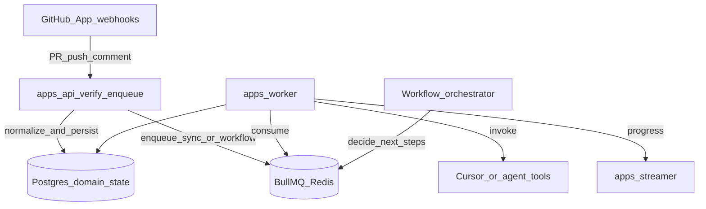
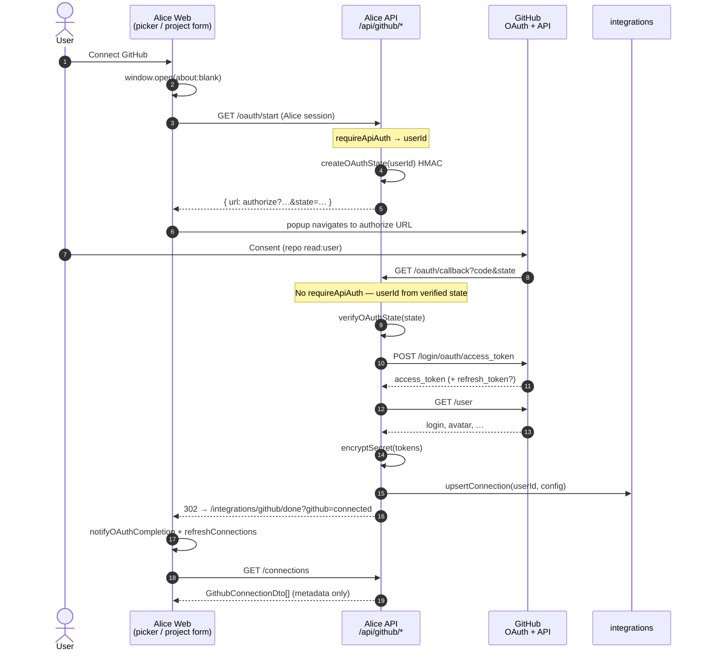

# GitHub Integration — OAuth today, GitHub App + orchestrator planned

**Status (shipped):** GitHub **OAuth App** (Authorization Code) with AES-256-GCM
encryption-at-rest and JIT refresh — enough to connect an account, bind one
`owner/repo` per project, and **manually** link PRs to work items.

**Status (planned):** Migrate source control to a **GitHub App** (install +
webhooks + installation tokens), sync PRs/commits/branches automatically, then
feed an in-app **workflow orchestrator** that can enqueue **agent tools**
(e.g. Cursor) on `apps/worker`. See [Phased delivery (planned)](#phased-delivery-planned).

**Related:** [Projects README](./README.md),
[JIRA_INTEGRATION.md](./JIRA_INTEGRATION.md) (shared crypto and popup UX),
[WORKER_AND_STREAMER.md](../../architecture/WORKER_AND_STREAMER.md),
[INTEGRATION_SCOPES.md](../integrations/INTEGRATION_SCOPES.md),
user guide [project-integrations.md](../../user-guide/projects/project-integrations.md)

---

## North-star topology (planned)

GitHub App is the **event and install identity** plane. It must not call agent
tools directly. Alice normalizes domain state and events; the orchestrator
decides; workers execute.



| Layer | Owns | Does not own |
| ----- | ---- | ------------ |
| **GitHub App** | Install identity, permissions, webhooks, installation tokens, repo list | Agent prompts, workflow graphs, Cursor credentials |
| **SC sync** | Upsert PRs / commits / branches / comment refs; link to work items | “Resolve this issue” product decisions |
| **Workflow orchestrator** | Triggers, conditions, approvals, multi-step runs | Raw GitHub HMAC / token minting |
| **Agent integrations** | Cursor (and peers) as tools on the worker | GitHub App private keys |

---

## Phased delivery (planned)

| Phase | Deliverable | Depends on |
| ----- | ----------- | ---------- |
| **0** | App registration checklist + env shape in docs (this section) | — |
| **1** | Install UX + `installation_id` on `version_control_connections`; project bind via `vc_*` | 0 |
| **2** | Signed webhooks → enqueue → worker sync for **PRs, commits, branches** | 1 + worker skeleton |
| **3** | Normalized SC domain events + job kinds aligned with [WORKER_AND_STREAMER.md](../../architecture/WORKER_AND_STREAMER.md) | 2 |
| **4** | Workflow orchestrator MVP; agent tools (e.g. Cursor) with human-in-the-loop | 3 |
| **5** | Migrate off user OAuth; optional write-back (checks/comments); Issues policy TBD | 4 |

### Phase 0 — Foundations

- Register Alice **GitHub App** (draft permissions: Contents / Metadata / Pull
  requests / Commits **read**; webhook events `push`, `pull_request`,
  `create` / `delete`; **write** scopes deferred until Phase 4–5).
- Env shape (planned): `GITHUB_APP_ID`, `GITHUB_APP_PRIVATE_KEY`,
  `GITHUB_APP_WEBHOOK_SECRET`, install + callback URLs (alongside today’s
  `GITHUB_CLIENT_ID` / `GITHUB_CLIENT_SECRET` until Phase 5).
- Non-goal: no runtime App code required for Phase 0 beyond documentation.

### Phase 1 — Install + project bind

- Install UX: trust App on org/user → select repos (same product rhyme as Jira
  “connect then pick resource”; **auth model is App install**, not user 3LO).
- Persist `installation_id` (and account metadata) in
  `version_control_connections.provider_config`.
- Mint short-lived **installation tokens** for API calls.
- Keep project binding on `projects.vc_connection_id` /
  `projects.vc_external` (wire aliases `github_connection_id` / `github_repo`).
- New connects prefer App; legacy user OAuth remains until Phase 5.

### Phase 2 — Webhook ingest + domain sync

- Signed webhook endpoint on `apps/api` → verify → idempotent enqueue → **202**.
- Worker job kinds upsert into `version_control_pull_requests` (and
  commit/branch tables as designed).
- Auto and/or manual link to Alice work items (branch naming / commit trailers
  where possible). Manual PR link remains as fallback.
- **Out of scope:** GitHub Issues → Alice work items (avoids dual ontology with
  Jira import). Revisit as an explicit product choice later.

### Phase 3 — Normalized SC events + worker bridge

- Emit Alice domain events (e.g. `PullRequestOpened`, `PushReceived`, later
  `ReviewCommentReceived`) as orchestrator inputs — not raw GitHub payloads.
- Queue names / `job_runs` follow WORKER_AND_STREAMER; API never runs agent
  loops or BullMQ `Worker` processes.

### Phase 4 — Workflow orchestrator + agent tools

- In-app workflows subscribe to SC events; enqueue agent steps on `apps/worker`.
- Cursor (and peers) live as **org agent integrations/tools** (Settings vault /
  agent connectors), **not** columns on `version_control_connections`.
- Default **human-in-the-loop** for “resolve from PR comment” and architecture
  proposals; optional post-back to GitHub when write permissions exist.

### Phase 5 — Migration + write-back

- Migrate or require re-install off user OAuth App connections.
- Expand App permissions for checks / PR comments as workflows need.
- Optional GitHub Issues policy (link vs import) as a separate decision.

### Locks

- Auth: **GitHub App install**, not “more user OAuth scopes.”
- v1 sync: **PRs + commits + branches**; Issues later.
- Binding: **one** primary repo per Alice project (`vc_*`).
- Storage: extend `version_control_connections`; do **not** fold SC into
  Settings `integrations` rows (Phase F facade stays valid).
- Execution: sync and agents on **worker**; orchestrator reacts to Alice events.

---

## Architecture & Model (current — OAuth App)

GitHub integration today enables Alice workspaces to link pull requests, commits, and branches to work items, following the same OAuth UX pattern established by the Jira integration.

| Concern                 | Approach                                                                                                                                                                                                                |
| ----------------------- | ----------------------------------------------------------------------------------------------------------------------------------------------------------------------------------------------------------------------- |
| **Authentication Flow** | **GitHub OAuth 2.0 Authorization Code Flow** with signed HMAC `state` for CSRF protection and Alice `userId` binding (no DB session row for the in-flight OAuth)                                                        |
| **Client Credentials**  | Configured via environment variables: `GITHUB_CLIENT_ID`, `GITHUB_CLIENT_SECRET`, `GITHUB_REDIRECT_URI`                                                                                                                 |
| **Requested Scopes**    | Least privilege: `repo read:user`                                                                                                                                                                                       |
| **Token Storage**       | `version_control_connections` (`vendor: github`). Tokens in `access_token_enc` / `refresh_token_enc` (AES-256-GCM `v1:...`). Non-secret fields in `provider_config` JSONB. Strategy A RLS (service-role / Prisma only). |
| **Project Binding**     | `projects.vc_connection_id` (FK) + `projects.vc_external` e.g. `{ "vendor": "github", "repo": "owner/repo" }`. HTTP/UI still use `github_repo` / `has_github_token` wire aliases.                                       |
| **PR links**            | `version_control_pull_requests` (was `github_pull_requests`) with `vendor` column                                                                                                                                       |
| **Token Refresh**       | **Just-In-Time (JIT) refresh**: `getValidAccessToken()` validates expiration with clock skew buffer (60s) and refreshes via GitHub OAuth before upstream requests                                                       |
| **Client DTO**          | Decrypted tokens are **never** returned to the browser. Frontend receives `GithubConnectionDto` metadata only                                                                                                           |

### Mental model

| Layer                         | Role                                                                                    |
| ----------------------------- | --------------------------------------------------------------------------------------- |
| Alice login                   | Who is connecting (`requireApiAuth` on `/oauth/start` + `userId` inside signed `state`) |
| GitHub OAuth                  | Grants Alice’s OAuth app access to that GitHub account                                  |
| `version_control_connections` | Encrypted tokens + `provider_config` (created/updated **after** callback)               |
| `projects.vc_external`        | Which `owner/repo` to use (binding), not the credential itself                          |

---

## Environment Configuration

Store client credentials securely in `.env` (never commit secrets or client secrets):

```bash
# GitHub OAuth App Credentials
GITHUB_CLIENT_ID=gh_client_id_xxxxxx
GITHUB_CLIENT_SECRET=gh_client_secret_xxxxxx
# Must be the API callback (GitHub redirects the browser here), e.g.:
GITHUB_REDIRECT_URI=http://localhost:5000/api/github/oauth/callback

# Master Key for Encrypting Tokens at Rest + HMAC OAuth state (32-byte Base64)
INTEGRATION_TOKEN_ENCRYPTION_KEY=3q2+7vF9...
```

To generate a new 32-byte base64 encryption key:

```bash
node -e "console.log(require('crypto').randomBytes(32).toString('base64'))"
```

### What is a 32-byte Base64 key?

`INTEGRATION_TOKEN_ENCRYPTION_KEY` must decode from Base64 to **exactly 32 raw bytes**. That buffer is used for:

1. AES-256-GCM encryption of access/refresh tokens (`token-crypto.ts`)
2. HMAC-SHA256 signing of the OAuth `state` parameter (`oauth-state.ts`)

See also [JIRA_INTEGRATION.md](./JIRA_INTEGRATION.md) (same key).

---

## How OAuth `state` binds the Alice user (no DB flag)

**Short answer:** There is **no database flag or server-side OAuth session table**. The “shared memory” between start and callback is the `state` query string itself: a **self-contained, HMAC-signed payload** that Alice issues and later verifies cryptographically.

### What is inside `state`?

`createOAuthState` / `signOAuthState` in `apps/api/src/lib/secrets/oauth-state.ts` build:

```text
base64url(JSON({ userId, nonce, exp })) . base64url(HMAC-SHA256(body))
```

| Field     | Purpose                                                                  |
| --------- | ------------------------------------------------------------------------ |
| `userId`  | Alice user who clicked Connect (from `requireApiAuth` on `/oauth/start`) |
| `nonce`   | Random 16 bytes — uniqueness / CSRF hardness                             |
| `exp`     | Expiry (default **10 minutes**)                                          |
| signature | HMAC over the body with `INTEGRATION_TOKEN_ENCRYPTION_KEY`               |

GitHub does **not** interpret this payload. It only **echoes** the same `state` string back on the redirect to `/api/github/oauth/callback?code=…&state=…`.

### What happens on callback?

1. `verifyOAuthState(state)` recomputes the HMAC and compares with `timingSafeEqual`.
2. If the signature is wrong (tampered `userId`, forged state, wrong key) → reject.
3. If `exp` is past → reject (“try connecting again”).
4. On success, Alice **trusts `userId` from the signed payload** and upserts `integrations` for that id.

The callback route is **intentionally unauthenticated** (`requireApiAuth` is **not** used): the browser arriving from GitHub may not carry Alice’s session cookie the same way, and identity for “who started this connect” comes from verified `state`, not from re-looking-up “is this user in the system?” as a separate OAuth check.

There is **no** step that:

- Stores `state` / nonce in Postgres for later comparison, or
- Sets a “pending OAuth” flag on `users`, or
- Matches callback solely by “user exists in DB”

Existence of the user is only implied because `/oauth/start` required a live Alice session (`req.userId`). If that user were deleted before callback, upsert could fail on FK / constraints — that is incidental, not how binding works.

### Why this is enough

| Threat                                                     | Mitigation                                                                              |
| ---------------------------------------------------------- | --------------------------------------------------------------------------------------- |
| CSRF / attacker finishes OAuth into victim’s Alice account | Attacker cannot forge a valid HMAC for the victim’s `userId` without the encryption key |
| Replay of an old `state`                                   | `exp` TTL (10 minutes)                                                                  |
| Callback without Alice cookie                              | Designed that way — `state` carries identity                                            |

Implementation: `GithubService.buildAuthorizeUrl` → `createOAuthState`; `handleOAuthCallback` → `verifyOAuthState` then `upsertConnection`.

---

## End-to-end sequence



---

## OAuth UX Flow (Jira Parity)

1. **Connection Status**:
   - The project form (Step 3: Source Control) and Project Details Integrations card inspect active GitHub connections using `useGithubConnectionPicker()`.
   - If not connected, an amber "Status: Not connected" badge and a **"Connect GitHub"** button are displayed.
2. **Popup Authorization**:
   - Clicking "Connect GitHub" opens a new window/tab synchronously (`about:blank`) to prevent browser popup blockers (`useOAuthPopupManager`).
   - The client calls `GET /api/github/oauth/start` (authenticated) to obtain the signed GitHub authorization URL.
   - The popup navigates to GitHub for user consent (`prompt=select_account`).
3. **Callback & Completion**:
   - GitHub redirects to `GET /api/github/oauth/callback?code=...&state=...` on the **API**.
   - The backend validates HMAC `state`, exchanges the code for tokens, loads `/user`, encrypts tokens, upserts `integrations`.
   - The backend redirects the popup to `{FRONTEND_URL}/integrations/github/done?github=connected|denied|error`.
   - The done page (`OAuthCompletionView`) notifies the opener via `postMessage` / `BroadcastChannel` / `localStorage`, then the user can close the window.
4. **Auto-Detection**:
   - The parent listens for OAuth completion messages plus `focus` / `visibilitychange`, and refreshes connections without a full page reload.
5. **Connected State & Repository Selection**:
   - UI shows `@account_login`, avatar, green Connected badge.
   - Disconnect: `DELETE /api/github/connections/:id`.
   - Repos: `GET /api/github/repositories` (Bearer token via JIT `getValidAccessToken`), or manual `owner/repo` entry.
   - **No Personal Access Token (PAT) is entered in the UI** for the OAuth path.

---

## Source map

| Step                  | Location                                                              |
| --------------------- | --------------------------------------------------------------------- |
| Popup open + navigate | `apps/web/app/projects/_hooks/use-oauth-popup-manager.ts`             |
| Picker / refresh      | `apps/web/app/projects/_hooks/use-github-connection-picker.ts`        |
| Client API helpers    | `apps/web/app/projects/_services/projects.github.mutations.client.ts` |
| Done page             | `apps/web/app/integrations/github/done/page.tsx`                      |
| Routes                | `apps/api/src/routes/api/github/github.route.ts` (`/api/github`)      |
| OAuth + token logic   | `apps/api/src/routes/api/github/github.service.ts`                    |
| Persistence           | `apps/api/src/routes/api/github/github.repository.ts`                 |
| Signed `state`        | `apps/api/src/lib/secrets/oauth-state.ts`                             |
| Encrypt / decrypt     | `apps/api/src/lib/secrets/token-crypto.ts`                            |

---

## Security & Token Encryption

1. **Encryption at Rest**:
   - Tokens are encrypted using AES-256-GCM with a random 12-byte IV and 16-byte authentication tag: `v1:<iv>:<tag>:<ciphertext>`.
   - Implemented in `apps/api/src/lib/secrets/token-crypto.ts`.
2. **Backend-Only Decryption**:
   - Decryption and scope validation take place strictly in `GithubService` (and consumers such as work-item PR flows) on the API.
   - Decrypted tokens are never serialized to the client and must not be logged.
3. **JIT refresh**:
   - If `expires_at` is within 60s of now and a refresh token exists, Alice calls GitHub’s refresh grant, re-encrypts, and updates `integrations`.
   - Missing/failed refresh → connection marked disabled + `GithubReauthorizationRequiredError`.
4. **Error Handling**:
   - `GithubReauthorizationRequiredError`: refresh expired or user revoked consent.
   - `GithubInsufficientScopeError`: granted scopes lack repository access (`repo` / `public_repo`).
