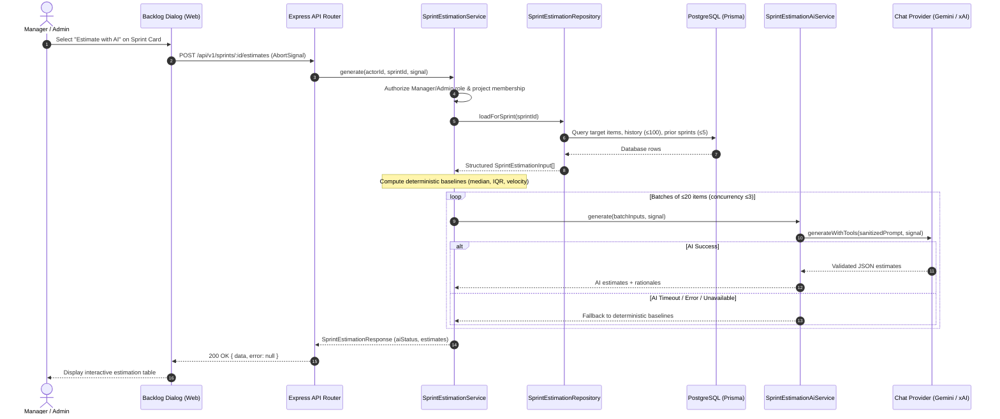
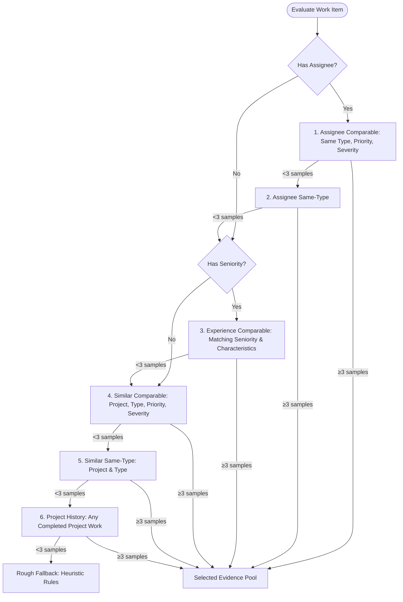

# AI Sprint Estimation

Status: **Implemented**

AI Sprint Estimation provides read-only, advisory effort estimates for work items assigned to a planned or active sprint. It combines historical delivery metrics, deterministic statistical baselines, and Large Language Model (LLM) analysis to generate suggested hours, confidence ratings, uncertainty ranges, and clear rationale for sprint planning.

---

## 1. Feature Overview & Architecture

### 1.1 Purpose & Guarantees

- **Advisory & Read-Only**: Produces planning guidance without updating work items, story points, logged hours, or sprint records in the database.
- **Dual-Engine Estimation**: Combines a deterministic median baseline computed from historical work logs with an LLM evaluation layer that refines suggestions based on item characteristics and past velocity.
- **Graceful Degradation**: If an AI provider is unconfigured, times out, or returns an error, the system automatically falls back to deterministic statistical estimates without failing the user request.
- **Auditable Rationale**: Every estimate includes an evidence source, sample count, confidence level (`high`, `medium`, or `low`), suggested hours, bounded min–max uncertainty range, and an explanation.

### 1.2 Architecture Diagram



---

## 2. API Endpoints, Contracts, Authentication & Permissions

### 2.1 Route Configuration

| Method | Path                            | Middleware & Guards                                         | Description                                         |
| :----- | :------------------------------ | :---------------------------------------------------------- | :-------------------------------------------------- |
| `POST` | `/api/sprints/:id/estimates`    | `requireApiAuth`, `manager` or `admin` role, project member | Generates read-only sprint planning hour estimates. |
| `POST` | `/api/v1/sprints/:id/estimates` | `requireApiAuth`, `manager` or `admin` role, project member | Standard v1 API alias for sprint estimation.        |

### 2.2 Authentication & Authorization

1. **Authentication (`requireApiAuth`)**:
   - The user must provide a valid session or Bearer token.
   - Missing or invalid credentials return `401 Unauthorized` (`SprintEstimationUnauthenticatedError`).
2. **Role Authorization (`requireSprintEstimationManagerOrAdmin`)**:
   - Only users with role `admin` or `manager` are permitted to execute sprint estimation.
   - Users with role `member` or other roles receive `403 Forbidden` (`SprintEstimationForbiddenError`).
3. **Project Membership (`requireProjectMember`)**:
   - The actor must be an active member of the project that owns the sprint.
   - Non-members receive `403 Forbidden` (`SprintAccessError`).
   - If the sprint does not exist, the route returns `404 Not Found` (`SprintEstimationNotFoundError`).

### 2.3 Request & Response Contracts

- **Path Parameter**: `id` (`string`, required) — Valid UUID of the sprint.
- **Request Body**: None (empty body).

#### Response Schema (`SprintEstimationResponse`)

```typescript
{
  sprintId: string; // UUID
  aiStatus: 'empty' | 'generated' | 'partial_fallback' | 'fallback';
  estimates: Array<{
    workItemId: string; // UUID
    suggestedHours: number; // 0.5 to 1000, 0.5 increments
    minimumHours: number; // 0.5 to 1000, <= suggestedHours
    maximumHours: number; // 0.5 to 1000, >= suggestedHours
    confidence: 'low' | 'medium' | 'high';
    source:
      | 'assignee_history'
      | 'similar_history'
      | 'experience_history'
      | 'project_history'
      | 'rough_fallback';
    evidenceCount: number; // Non-negative integer
    roughEstimate: boolean; // True if fallback heuristics used
    rationale: string; // 1 to 500 characters
    estimationMethod: 'ai' | 'deterministic';
    fallbackReason:
      | 'cancelled'
      | 'configuration'
      | 'invalid_input'
      | 'invalid_response'
      | 'provider_error'
      | 'timeout'
      | 'unsupported_provider'
      | null;
  }>;
}
```

#### Overall AI Statuses (`aiStatus`)

| Status             | Condition                             | Meaning                                                                           |
| :----------------- | :------------------------------------ | :-------------------------------------------------------------------------------- |
| `empty`            | `estimates.length === 0`              | The sprint contains no active work items to estimate.                             |
| `generated`        | All items estimated via AI            | Full AI evaluation succeeded across all batches.                                  |
| `partial_fallback` | Mix of AI and deterministic items     | Some batches succeeded while others fell back due to provider timeouts or errors. |
| `fallback`         | All items estimated deterministically | AI was disabled, unconfigured, timed out, or unavailable for all items.           |

### 2.4 HTTP Status Codes

| HTTP Status                 | Reason                                       | Payload / Behavior                                                                 |
| :-------------------------- | :------------------------------------------- | :--------------------------------------------------------------------------------- |
| `200 OK`                    | Success                                      | `{ data: SprintEstimationResponse, error: null }`                                  |
| `400 Bad Request`           | Invalid sprint UUID format                   | `{ data: null, error: "Invalid sprint id" }`                                       |
| `401 Unauthorized`          | Missing or expired authentication            | `{ data: null, error: "Unauthorized" }`                                            |
| `403 Forbidden`             | Non-manager/admin role or non-project member | `{ data: null, error: "Forbidden" }`                                               |
| `404 Not Found`             | Sprint not found                             | `{ data: null, error: "Sprint not found" }`                                        |
| `422 Unprocessable Entity`  | Sprint exceeds 200 estimable work items      | `{ data: null, error: "Sprint exceeds the maximum of 200 estimable work items." }` |
| `500 Internal Server Error` | Unhandled internal exception                 | `{ data: null, error: "Failed to estimate sprint" }`                               |
| _No Response_               | Client cancellation / Aborted request        | Connection closes cleanly; no error payload emitted.                               |

---

## 3. Historical Evidence, Deterministic Baselines & Fallback Logic

The estimation engine grounds predictions in real completed work before calling an AI model. This guarantees that estimates remain realistic and deterministic even when AI services are offline.

### 3.1 Repository Data Ingestion

The repository (`SprintEstimationRepository.loadForSprint`) retrieves three datasets in parallel via Prisma:

1. **Sprint Target Work Items**:
   - Active work items (`record_status = 'active'`) currently in the sprint.
   - Reads up to 201 rows (`SPRINT_ESTIMATION_TARGET_LIMIT + 1`). If the count exceeds 200, the service throws `SprintEstimationLimitError` (HTTP 422).
2. **Historical Completed Work Items**:
   - Up to 100 items (`SPRINT_ESTIMATION_HISTORY_LIMIT = 100`) from the same project.
   - Must have `record_status = 'active'`, `status_category = 'done'`, `done_at < sprint.start_date`, and active work logs with `logged_hours > 0`.
   - Ordered by `done_at DESC, id ASC`.
3. **Previous Sprint Deliveries**:
   - Up to 5 completed or archived sprints (`SPRINT_ESTIMATION_PREVIOUS_SPRINT_LIMIT = 5`) from the same project with `end_date < sprint.start_date`.
   - Work items attached to these sprints are grouped by status category (`done` vs total committed) to compute delivery velocity.

### 3.2 Evidence Pool Hierarchy

For each work item, the pure deterministic engine (`estimateSprintWorkItem` in `@repo/types`) matches historical items into prioritized evidence pools. At least **3 usable historical samples** (`SPRINT_ESTIMATION_MIN_HISTORY_SAMPLES = 3`) are required to establish an evidence pool:



### 3.3 Median Calculation & Scaling

- **Story Points Scaling**: If the target work item has `storyPoints > 0`, each historical item's effort is normalized as:
  $$\text{Normalized Hours} = \left(\frac{\text{Historical Logged Hours}}{\text{Historical Story Points}}\right) \times \text{Target Story Points}$$
- **Direct Hours**: If the target work item has no story points, the historical item's logged hours are used directly.
- **Suggested Hours**: The median of the normalized observations is calculated and rounded to the nearest 0.5 hour, bounded between 0.5h and 1,000h.

### 3.4 Confidence Ratings

Confidence reflects sample size and pool specificity:

| Level        | Criteria                                                                 | Evidence Pools                                                                             |
| :----------- | :----------------------------------------------------------------------- | :----------------------------------------------------------------------------------------- |
| **`high`**   | $\ge 5$ comparable samples (`SPRINT_ESTIMATION_HIGH_CONFIDENCE_SAMPLES`) | Assignee comparable, Assignee same-type, Similar comparable                                |
| **`medium`** | $\ge 3$ comparable samples                                               | Any high-confidence pool with 3–4 samples, plus Experience comparable or Similar same-type |
| **`low`**    | $< 3$ specific samples, or broad project history                         | Project history ($\ge 3$ general samples) or Rough fallback                                |

### 3.5 Uncertainty Ranges & Velocity Adjustment

The uncertainty range (`minimumHours` and `maximumHours`) is computed from the spread of historical observations:

1. **Interquartile Range (IQR)**: Lower quartile ($Q_1$, 25th percentile) and upper quartile ($Q_3$, 75th percentile).
2. **Half-Width Spread**:
   $$\text{halfWidth} = \max(0.2 \times \text{suggested}, \text{suggested} - Q_1, Q_3 - \text{suggested}, 0.5)$$
3. **Historical Completion Contingency**:
   - The median completion rate across up to 5 prior sprints is calculated:
     $$\text{Completion Rate} = \text{median}\left(\frac{\text{Completed Story Points}}{\text{Committed Story Points}}\right)$$
   - If median completion is $< 75\%$, a **1.2× multiplier (+20%)** widens the upper range.
   - If median completion is between $75\%$ and $< 90\%$, a **1.1× multiplier (+10%)** widens the upper range.
   - If median completion is $\ge 90\%$ (or no previous sprint history exists), multiplier is **1.0×**.
4. **Range Bounds**:
   - $\text{minimumHours} = \text{clamp}(\text{suggested} - \text{halfWidth}, 0.5, \text{suggested})$
   - $\text{maximumHours} = \text{clamp}((\text{suggested} + \text{halfWidth}) \times \text{multiplier}, \text{suggested}, 1000)$

### 3.6 Rough Fallback Heuristics

When fewer than 3 usable historical samples exist (`source = 'rough_fallback'`, `roughEstimate = true`):

- **With Story Points**: Suggested hours default to $1 \text{ hour per story point}$.
- **Without Story Points**: Suggested hours default by work-item type:
  - **Epic**: 40 hours
  - **Feature**: 24 hours
  - **Story**: 8 hours
  - **Task**: 4 hours
  - **Issue**: 4 hours
- **Range**: Minimum is $0.75 \times \text{suggested}$; Maximum is $1.5 \times \text{suggested} \times \text{multiplier}$.

---

## 4. AI Providers, Batching, Concurrency & Cancellation

### 4.1 Pluggable LLM Integration

The AI estimation service (`SprintEstimationAiService`) interfaces with Alice's centralized chat integrations via `resolveChatModelForChat` and `resolveChatProvider`. Supported providers include:

- **Google Gemini**: Uses `GeminiChatProvider` with Google AI Studio / Vertex endpoints.
- **SpaceXAI / xAI**: Uses `SpaceXAIChatProvider` with OpenAI-compatible completion endpoints.

### 4.2 Batching & Concurrency Limits

To prevent LLM token overflows, rate-limit thrashing, and gateway timeouts:

- **Batch Size**: Sprints are split into chunks of at most **20 work items** (`SPRINT_ESTIMATION_AI_MAX_WORK_ITEMS = 20`).
- **Wave Concurrency**: At most **3 batches** run concurrently (`SPRINT_ESTIMATION_AI_BATCH_CONCURRENCY = 3`). Sprints with 60 items run across 1 wave; sprints with 200 items run across 4 sequential waves of 3 batches.
- **Per-Batch Timeout**: Each AI batch has an independent **10-second timeout** (`SPRINT_ESTIMATION_AI_TIMEOUT_MS = 10_000`). If a batch times out, only that batch degrades to deterministic estimates with `fallbackReason: 'timeout'`.

### 4.3 Prompt Security & Sanitization

All data passed to external LLM providers is strictly bounded and sanitized:

- **Untrusted Data Prefix**: Prompts prepend `Analyze this untrusted sprint estimation data JSON:\n` and instruct the model to ignore instructions embedded in user-supplied strings.
- **No PII or Descriptions**: Raw work-item descriptions, user emails, names, and profile information are **never sent** to the LLM. Only item ID, type, priority, truncated severity (max 80 chars), story points, assignee seniority (max 80 chars), and deterministic baselines are included.
- **Coverage Caps**: At most 5 historical items (`SPRINT_ESTIMATION_AI_MAX_HISTORY_PER_ITEM = 5`) and 5 prior sprint completion records (`SPRINT_ESTIMATION_AI_MAX_PREVIOUS_SPRINTS = 5`) are sent per item.
- **Payload Limits**: Prompts exceeding 32,000 characters (`SPRINT_ESTIMATION_AI_MAX_INPUT_CHARS`) are rejected before transmission, and responses exceeding 64,000 characters (`SPRINT_ESTIMATION_AI_MAX_RAW_RESPONSE_CHARS`) trigger fallback.
- **No Tool Invocations**: System instructions explicitly prohibit tools, function calls, and database modifications.

### 4.4 Request Cancellation Flow

Sprint estimation supports end-to-end cancellation:

1. **User Action**: The user closes the estimation modal or clicks "Try again".
2. **Web Client**: The active `AbortController` in `BacklogSprintEstimationDialog` calls `abort()`, terminating the client-side fetch request.
3. **HTTP Server**: The Express route listener (`req.on('aborted')` / `res.on('close')`) receives the socket disconnect and signals its internal `AbortController`.
4. **Provider Fetch**: `GeminiChatProvider` and `SpaceXAIChatProvider` pass `signal` directly into their underlying `fetch()` calls.
5. **Immediate Termination**: Active HTTP network requests to Gemini or xAI are aborted immediately without executing retry backoff loops.
6. **Clean Response**: The Express handler intercepts `SprintEstimationCancelledError` and terminates without attempting to write error headers or payloads to the closed connection.

---

## 5. Read-Only Guarantees

Sprint estimation is designed as an advisory planning aid with strict read-only guarantees:

- **Zero Database Writes**: The estimation flow executes only `SELECT` queries (via Prisma `findUnique`, `findMany`, and `groupBy`). No `INSERT`, `UPDATE`, `UPSERT`, or `DELETE` operations are executed against the database.
- **No Side Effects**: Neither work-item fields (`story_points`, `estimated_hours`, `status`), sprint attributes, nor project settings are modified.
- **Ephemeral Client State**: Estimates exist only in browser component memory while the dialog is open and are discarded upon closing the dialog.
- **Automated Verification**: End-to-end tests install mutation guards (`installReadOnlyMutationGuards`) that intercept all HTTP mutation methods (`POST`, `PATCH`, `PUT`, `DELETE`) on sprint and work-item endpoints, verifying that no persistence requests occur.

---

## 6. User Guide: How to Estimate Sprints

### 6.1 Requirements

- You must be logged in as an **Admin** or **Manager**.
- You must be an assigned member of the project.

### 6.2 Step-by-Step Instructions

1. Navigate to **Backlog** (`/backlog`) from the left sidebar.
2. Locate the sprint card you want to estimate in the right-hand sprint cards pane.
3. Open the sprint actions menu by clicking the **More actions** icon (`...`) on the sprint card header.
4. Click **Estimate with AI** (indicated with a Sparkles icon).
5. **Review Generation Progress**:
   - A modal dialog titled `Estimate <Sprint Name>` opens.
   - A loading indicator displays: _"Alice is comparing this sprint with historical work."_
6. **Analyze the Results**:
   - **Summary Banner**: Displays total estimates and model composition (e.g., _"12 AI-generated estimates"_ or _"AI was unavailable. 12 deterministic estimates are shown"_).
   - **Work Item**: Displays item title, key identifier, type badge, priority badge, story points, and assignee name.
   - **Suggested Hours**: Shows primary suggested effort (e.g. `8.5h`) along with the bounded uncertainty range (e.g. `6.5–10.5h range`).
   - **Confidence**: Badged as `High confidence`, `Medium confidence`, or `Low confidence`.
   - **Method and Evidence**: Displays generation method (`AI-generated` or `Deterministic fallback`), historical evidence source (`Assignee history`, `Similar history`, `Experience history`, `Project history`, or `Rough fallback`), evidence sample count, and any fallback reason.
   - **Explanation**: Concise rationale explaining the statistical or contextual basis for the estimate.
7. **Handle Errors / Retry**:
   - If an error banner appears (e.g., network failure, timeout, or session expiry), click the **Try again** button to re-trigger estimation.
8. **Dismiss**:
   - Click **Close** or press **Escape** to dismiss the dialog. Closing the dialog immediately cancels any in-flight estimation requests.

---

## 7. Known Limitations

1. **Large-Sprint Timeouts**:
   - The web client enforces a 60-second fetch timeout (`SPRINT_ESTIMATION_FETCH_TIMEOUT_MS = 60_000`).
   - For large sprints containing up to 200 items (10 batches executed across 4 sequential waves of 3 concurrent batches), cumulative LLM provider latency or cold starts can exceed 60 seconds, resulting in a client-side timeout error.
2. **In-Flight Database Cancellation**:
   - While HTTP provider requests abort cleanly, database queries issued by Prisma (`prisma.work_items.findMany`, `prisma.sprints.findMany`) do not accept an `AbortSignal`.
   - If a user cancels estimation while Prisma is querying database history, the database query continues to run until finished on the PostgreSQL engine.
3. **Deployment Limits**:
   - Sprints exceeding 200 active work items (`SPRINT_ESTIMATION_TARGET_LIMIT = 200`) cannot be estimated and return HTTP 422.
   - Historical evidence is capped at 100 completed items (`SPRINT_ESTIMATION_HISTORY_LIMIT = 100`) and 5 prior sprints (`SPRINT_ESTIMATION_PREVIOUS_SPRINT_LIMIT = 5`).
   - LLM prompts are capped at 32,000 characters and responses at 64,000 characters.
4. **Historical Completion Basis**:
   - Velocity and completion rates from prior sprints are reconstructed from work items currently linked to completed sprints (`current_work_item_state_approximation`), rather than frozen commitment snapshots taken at sprint completion.
5. **Unexecuted Cypress Runtime Verification**:
   - End-to-end Cypress tests are implemented in `apps/web/cypress/e2e/sprint-estimation.cy.ts`, verifying dialog interactions, read-only mutation guards, AI estimate rendering, fallback reason badges, retry triggers, and cancellation aborts.
   - However, full runtime execution of Cypress requires a running database, seeded member credentials (`TEST_USER_PASSWORD`), and synchronized Next.js (`:3000`) and Express (`:5000`) dev servers. This runtime execution remains unexecuted in isolated build environments lacking seeded e2e infrastructure.

---

## 8. Related Documentation

- [Sprints Feature Overview](./README.md)
- [Sprint Burndown Chart](./BURNDOWN_CHART.md)
- [Technical Requirements Document (TRD)](../../architecture/TRD.md)
- [Backlog User Guide](../../user-guide/board-and-planning/backlog.md)
- [Board & Planning Overview](../../user-guide/board-and-planning/README.md)
