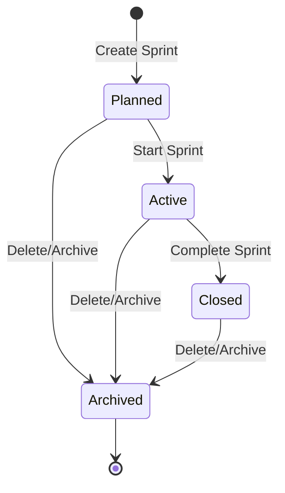

# Sprints Feature Documentation

Status: **Implemented**

Sprints in ALICE are time-boxed iterations within a project that group work items, track team velocity, and measure progress using burn-down metrics, completion reports, and AI-powered effort estimation.

---

## 1. Documentation Index

| Document                                                                                               | Description                                                                                                 | Status                    |
| :----------------------------------------------------------------------------------------------------- | :---------------------------------------------------------------------------------------------------------- | :------------------------ |
| [AI_SPRINT_ESTIMATION.md](./AI_SPRINT_ESTIMATION.md)                                                   | Read-only sprint effort estimation using historical logged hours, deterministic medians, and LLM evaluation | Implemented               |
| [BURNDOWN_CHART.md](./BURNDOWN_CHART.md)                                                               | Burndown chart design, ideal line, work logs, capacity; Charts widget rollup link                           | Implemented + Charts next |
| [CHARTS_AGGREGATION.md](../dashboard/CHARTS_AGGREGATION.md#charts-burndown-widget-next-implementation) | Charts burndown rollup + widget implementation steps                                                        | Planned                   |
| [ARD.md](../../product/ARD.md) (SPR-1)                                                                 | Product architecture decision records for sprint management                                                 | Living                    |
| [TRD.md](../../architecture/TRD.md)                                                                    | Technical requirements document for sprints & work items                                                    | Living                    |

---

## 2. Sprint Lifecycle & Status State Machine

A sprint moves through four standardized lifecycle states defined by `SprintStatus`:

| Status         | Meaning & Business Rules                                                                                                                                                                                                 |
| :------------- | :----------------------------------------------------------------------------------------------------------------------------------------------------------------------------------------------------------------------- |
| **`planned`**  | Newly created sprint. Work items can be assigned from the backlog. Start and end dates can be scheduled.                                                                                                                 |
| **`active`**   | The sprint is in progress. Only one sprint per project may be active concurrently. The actual-remaining burndown line updates dynamically day by day.                                                                    |
| **`closed`**   | The sprint is finalized. Velocity and completion rates are computed and locked. Unfinished work items can be rolled over to the next sprint or returned to the backlog.                                                  |
| **`archived`** | Soft-deleted sprint record. Retained for audit purposes but omitted from active boards and dropdown selectors. Sprint names remain unique per project even when archived, so you cannot reuse an archived sprint’s name. |

---

## 3. UX Surfaces

| Surface                   | Route                                                                   | Behavior                                                                                                                                                                                                                                                                                                                                                |
| :------------------------ | :---------------------------------------------------------------------- | :------------------------------------------------------------------------------------------------------------------------------------------------------------------------------------------------------------------------------------------------------------------------------------------------------------------------------------------------------ |
| **Sprints Registry**      | Project → **Sprints** (`/projects/[id]?tab=sprints`); legacy `/sprints` | Displays sprints for the project (or accessible projects on `/sprints`), with Active/Archived tabs and search. Create/edit sprints, dates, and status transitions. Managers and admins only.                                                                                                                                                            |
| **Backlog Planning**      | `/backlog`                                                              | Split-view backlog manager allowing team members to drag or assign backlog work items into planned and active sprints. Includes the **Estimate with AI** action for managers/admins to open advisory hour estimation dialogs.                                                                                                                           |
| **Sprint Summary Report** | `/sprints/[id]/report`                                                  | Live retrospective (stats, charts, deliverables) for active/closed/archived sprints; **planned** sprints show the same layout as an inaccessible placeholder until the sprint starts. Breadcrumb is project-scoped when the sprint has a project: `Dashboard → Projects → {project} → Sprints → {sprint}` (Sprints opens `/projects/[id]?tab=sprints`). |
| **Alice Assistant**       | `/chat` & Drawer                                                        | Conversational interface where Alice can invoke `list_sprints` and `create_sprint` via natural language.                                                                                                                                                                                                                                                |

---

## 4. API Endpoints

All sprint routes require authentication (`requireApiAuth`) and project membership:

| Method   | Path                            | Description                                                               | Permissions          |
| :------- | :------------------------------ | :------------------------------------------------------------------------ | :------------------- |
| `GET`    | `/api/sprints`                  | List sprints for a project (`projectId` query param), filtered by status. | Authenticated member |
| `POST`   | `/api/sprints`                  | Create a new sprint in `planned` status.                                  | Manager / Admin      |
| `GET`    | `/api/sprints/:id`              | Get sprint details by ID.                                                 | Authenticated member |
| `PATCH`  | `/api/sprints/:id`              | Update sprint metadata (`name`, `goal`, `startDate`, `endDate`).          | Manager / Admin      |
| `PATCH`  | `/api/sprints/:id/status`       | Transition sprint status (`active`, `closed`, `archived`).                | Manager / Admin      |
| `DELETE` | `/api/sprints/:id`              | Soft-delete/archive sprint and handle uncompleted work items.             | Manager / Admin      |
| `GET`    | `/api/sprints/:id/burndown`     | Retrieve calculated burndown series (ideal vs actual remaining points).   | Authenticated member |
| `GET`    | `/api/sprints/:id/report`       | Retrieve sprint completion statistics and metrics.                        | Authenticated member |
| `POST`   | `/api/sprints/:id/estimates`    | Generate advisory effort estimates and uncertainty ranges.                | Manager / Admin      |
| `POST`   | `/api/v1/sprints/:id/estimates` | Standard v1 alias for sprint effort estimation.                           | Manager / Admin      |

---

## 5. Database Schema

Defined in `packages/db/prisma/schema.prisma`:

### Model: `sprints`

| Field        | Type           | Attributes                           | Description                               |
| :----------- | :------------- | :----------------------------------- | :---------------------------------------- |
| `id`         | `UUID`         | `@id`, `@default(gen_random_uuid())` | Primary key                               |
| `name`       | `String`       |                                      | Sprint name (e.g. "Sprint 14")            |
| `goal`       | `String?`      |                                      | Objective of the sprint                   |
| `project_id` | `UUID`         | FK → `projects.id`                   | Associated project                        |
| `start_date` | `DateTime`     | `@db.Date`                           | Scheduled start date                      |
| `end_date`   | `DateTime`     | `@db.Date`                           | Scheduled end date                        |
| `status`     | `SprintStatus` | `@default(planned)`                  | `planned`, `active`, `closed`, `archived` |
| `created_by` | `UUID?`        | FK → `users.id`                      | Audit creator                             |
| `created_at` | `DateTime`     | `@default(now())`                    | Timestamp                                 |
| `updated_by` | `UUID?`        | FK → `users.id`                      | Audit updater                             |
| `updated_at` | `DateTime`     | `@updatedAt`                         | Timestamp                                 |

### Relations

- `project`: Belongs to `projects` (Cascade delete).
- `work_items`: One-to-many relationship with `work_items.sprint_id`.
- `done_at`: Work items transition timestamp used to plot the actual burndown curve when work logs are absent.

---

## 6. AI Integrations

### 6.1 Conversational Chat Tools

Alice interacts with sprints through dedicated function-calling tools:

1. **`list_sprints`**:
   - Queries active, planned, or closed sprints for a specified project.
   - Provides context when users ask: _"What sprints are currently active?"_ or _"List all sprints for project Alpha."_
2. **`create_sprint`**:
   - Allows users to create sprints conversationally:
     > _"Create Sprint 12 for Project Mobile from October 1 to October 15 with goal 'Launch Auth flow'"_
   - Returns deep links in the chat thread to jump directly to the newly created sprint.

### 6.2 AI Sprint Estimation Service

The sprint estimation engine provides advisory, read-only effort predictions:

- **Dual-Engine Pipeline**: Computes a deterministic median baseline grounded in historical logged hours (scaled by story points or item types), then refines estimates using LLM evaluation (Google Gemini or SpaceXAI).
- **Graceful Fallback**: If the AI model times out (10s per batch) or encounters provider errors, the system automatically degrades to deterministic statistical estimates with explicit fallback reason badges.
- **Batching & Concurrency**: Items are partitioned into batches of up to 20 items and evaluated in waves of at most 3 concurrent batches.
- **Read-Only**: Purely advisory. No updates or database modifications are performed.
- Detailed architecture, mathematical algorithms, confidence scoring, and contracts are documented in [AI_SPRINT_ESTIMATION.md](./AI_SPRINT_ESTIMATION.md).

---

## 7. Testing

### Automated Test Coverage

- **Repository tests**: `apps/api/tests/sprints/sprint-estimation.repository.test.ts`, `apps/api/tests/sprints/sprints.repository.test.ts`
- **Service & calculations**:
  - Burndown math & velocity: `apps/api/tests/sprints/`
  - Sprint estimation pure algorithms: `apps/api/tests/sprints/sprint-estimation.test.ts`
  - Sprint estimation service: `apps/api/tests/sprints/sprint-estimation.service.test.ts`
  - AI estimation service: `apps/api/tests/sprints/sprint-estimation.ai.service.test.ts`
  - Chat provider cancellation tests: `apps/api/tests/integrations/gemini-chat.provider.test.ts`, `spacexai-chat.provider.test.ts`
- **API routing & contracts**:
  - Express route tests: `apps/api/tests/sprints/sprint-estimation.route.test.ts`
  - Schema validation: `apps/api/tests/sprints/sprint-estimation.schemas.test.ts`
  - End-to-end integration: `apps/api/tests/sprints/sprint-estimation.integration.test.ts`
- **Web components**:
  - Backlog estimation dialog: `apps/web/tests/backlog/backlog-sprint-estimation-dialog.test.tsx`
  - Sprint card actions: `apps/web/tests/backlog/backlog-sprint-card.test.tsx`
  - API client helper: `apps/web/tests/sprints/sprint-estimation-api.client.test.ts`
- **End-to-End behavior (Cypress)**:
  - Specification in `apps/web/cypress/e2e/sprint-estimation.cy.ts` covers dialog opening, read-only mutation guards, AI estimate rendering, fallback reason badges, retry triggers, and cancellation aborts.
